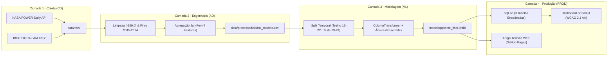

# SojaRisco - Sistema Inteligente de Previsão de Risco de Quebra de Safra (Trilha C)

**Disciplina:** Ciência de Dados e Aprendizado de Máquina (2026/2)  
**Recorte Agronômico:** Soja em Grão (`Glycine max`) - Município de **Sorriso - MT** (Código IBGE: `5107925`)  
**Fontes de Dados Abertos:** [NASA POWER Daily API](https://power.larc.nasa.gov/) & [IBGE SIDRA - Pesquisa Agrícola Municipal (PAM, Tabela 1612)](https://sidra.ibge.gov.br/tabela/1612)

---

## Links Rápidos das Entregas Oficiais

| Entrega Oficial | Acesso Público / Caminho no Repositório | Status |
| :--- | :--- | :---: |
| **Artigo Técnico Web (GitHub Pages)** | [https://samukiszhsd.github.io/bx_produtividade_agricola/](https://samukiszhsd.github.io/bx_produtividade_agricola/) (`docs/index.html`) | Publicado |
| **Dashboard Interativo (Streamlit Cloud)** | `streamlit_app.py` *(link público no Streamlit Community Cloud)* | Pronto / Ativo |
| **Vídeo Pitch (90 segundos - YouTube)** | *[Link Não Listado no YouTube - Placeholder Mostra]* | Estrutura Pronta |
| **QR Code do Artigo Técnico** | [`docs/img/qrcode_artigo.png`](docs/img/qrcode_artigo.png) / [`docs/img/qrcode_artigo.svg`](docs/img/qrcode_artigo.svg) | Gerado |
| **Diário de Bordo Consolidado (S1-S5)** | [`DIARIO.md`](DIARIO.md) e [`docs/sprints/Sprint1..5_TrilhaC.md`](docs/sprints/) | Atualizado |
| **Quadro de Tarefas Scrum (`tarefas.md`)** | [`tarefas.md`](tarefas.md) e [Quadro Oficial no Trello](https://trello.com/invite/b/6a975ab20fa3094b426c0c68/ATTI02cea94da7f784bcf30e1e3d24341426A34F2CE2/📊-projeto-de-ciencia-de-dados) | Atualizado |
| **Model Card & Dicionário de Dados (v0.4)** | [`docs/Model_Card.md`](docs/Model_Card.md) e [`docs/Dicionario_de_Dados.md`](docs/Dicionario_de_Dados.md) | Atualizado |

### Equipe de Desenvolvimento (Grupo 3 - Sistemas de Informação)
- **João Guilherme Cravo** (RGM: `35880759`) - *Scrum Master (S1-S4), Engenharia de Dados Idempotente, SQLite & Artigo Web*
- **Jean Carlos Silva de Almeida** (RGM: `33783276`) - *Pipelines Scikit-Learn, Split Temporal Estrito, Limiar & Model Card*
- **Samuel Allan Nunes da Cunha** (RGM: `34524746`) - *Scrum Master (S5), Modelagem de Árvores/Ensembles & Dashboard Streamlit*

---

## Escopo do Projeto - Canvas de Kickoff (8 Perguntas Obrigatórias)

Antes da coleta de dados, o grupo delimitou o escopo técnico e de negócio respondendo às oito perguntas do Canvas de Kickoff (detalhadas no [`docs/RFC.md`](docs/RFC.md)):

| # | Pergunta do Canvas | Resposta Definida pelo Grupo (Trilha C - Sorriso/MT) |
| :---: | :--- | :--- |
| **1** | **Qual evento temporal ou agrícola será antecipado?** | A ocorrência de **quebra severa de produtividade na safra anual de soja** (`quebra_safra = 1`), definida tecnicamente quando o rendimento médio municipal cai abaixo de **3.400 kg/ha** (frente à média histórica de 3.477 kg/ha em Sorriso-MT). |
| **2** | **Qual a delimitação de região, município ou cultura?** | Cultura de **Soja em Grão** no município de **Sorriso - MT** (Código IBGE `5107925`, Lat `-12.5414°`, Lon `-55.7269°`), capital nacional do agronegócio e maior produtor mundial de soja, com série histórica consistente de 10 safras consolidadas (2015 a 2024). *(Nota: a safra de 2025 foi descartada por ainda não possuir fechamento oficial no IBGE PAM).* |
| **3** | **Qual é o exato horizonte de previsão de risco?** | O alerta é emitido no **fechamento de fevereiro (28/02 de cada ano-safra)**, utilizando exclusivamente variáveis agroclimáticas observadas durante o bimestre crítico de floração e enchimento de grãos (**Janeiro e Fevereiro**), antecipando o resultado oficial da colheita em **30 a 45 dias**. |
| **4** | **Qual a tolerância a Falsos Positivos versus Falsos Negativos?** | **Baixíssima tolerância ao Falso Negativo (FN).** Um Falso Positivo (alarme falso) gera apenas o custo cautelar de proteção financeira ou vistoria técnica; já um **Falso Negativo (quebra silenciosa)** expõe o produtor à perda catastrófica da lavoura sem seguro rural e ao inadimplemento de contratos futuros (custo estimado 5x superior ao FP). Por isso, a métrica principal do projeto é o **Recall da classe positiva (quebra)**, acompanhado do **F1-Score**. |
| **5** | **Quem utilizará o alerta e qual ação ele engatilha?** | **Produtores rurais, cooperativas agropecuárias e seguradoras rurais** de Sorriso-MT. O alerta de risco alto engatilha: (a) acionamento antecipado de apólices e perícia de seguro rural; (b) trava cautelar na venda antecipada de sacas no mercado futuro (*hedge*); e (c) replanejamento logístico de armazenamento e frete pela cooperativa. |
| **6** | **Quais são as fontes de dados abertos e como elas se relacionam?** | **NASA POWER Daily API** (dados meteorológicos e de umidade radicular diários em grade de $0,5^\circ \times 0,5^\circ$ centrada na sede municipal de Sorriso-MT) cruzada por `ano` com o **IBGE SIDRA PAM (Agregado 1612)**, que fornece o rendimento anual consolidado em kg/ha por município. |
| **7** | **Qual é o principal risco de vazamento de dados (*Data Leakage*) e como evitá-lo?** | Dois riscos mitigados: (1) **Vazamento intra-safra:** usar chuvas de março a dezembro após a colheita da soja - evitado restringindo todas as features preditivas aos meses de **Janeiro e Fevereiro**; (2) **Vazamento temporal entre safras:** misturar anos futuros no treino - evitado com **Split Temporal Estrito** (Treino: `2015-2022`, $N=8$; Teste Cego: `2023-2024`, $N=2$) e `ColumnTransformer` ajustado (`.fit()`) exclusivamente no treino. |
| **8** | **Como o modelo será validado e entregue como sistema vivo?** | Validação temporal expansiva (*TimeSeriesSplit* / *Expanding Window* nos anos 2019-2022 dentro do treino) para escolha de hiperparâmetros e calibração de limiar, seguida de avaliação única no teste cego congelado (2023-2024). Entregue como sistema vivo com **pipeline serializado (`joblib`)**, **banco relacional SQLite de 3 tabelas encadeadas** e **Dashboard no Streamlit Community Cloud**. |

---

## Arquitetura do Sistema em 4 Camadas



---

## Estrutura Padronizada do Repositório

```text
bx_produtividade_agricola/
├── assets/
│   └── icons/                                # Ícones SVG vetoriais acessíveis do Dashboard
├── data/
│   ├── raw/                                  # Cache imutável das APIs (NASA POWER + IBGE PAM)
│   ├── interim/                              # Partições intermediárias (treino 2015-22 / teste 2023-24)
│   ├── processed/
│   │   └── dados_modelo.csv                  # Base final modelada (N=10 safras, 4 features Jan-Fev + alvo)
│   └── monitoramento_safra.db                # Banco SQLite relacional (dados_historicos, previsoes_sistemicas, logs_monitoramento)
├── docs/
│   ├── index.html                            # Artigo Técnico Web Público (GitHub Pages)
│   ├── css/style.css                         # Estilização editorial responsiva (Light/Dark WCAG AA)
│   ├── js/project-data.js                    # Camada de dados oficiais da Sprint 5 (is_mock: false)
│   ├── js/app.js                             # Simulador interativo da Árvore e Testador de API
│   ├── img/qrcode_artigo.png                 # QR Code oficial de acesso ao Artigo Técnico
│   ├── assets/                               # Gráficos gerados nos notebooks (árvore, curva de limiar, EDA)
│   ├── sprints/Sprint1..5_TrilhaC.md         # Diários de bordo detalhados das Sprints 1 a 5
│   ├── RFC.md                                # Request for Comments (Regras de negócio e custo de FN)
│   ├── Dicionario_de_Dados.md                # Contrato e linhagem das variáveis (v0.4)
│   └── Model_Card.md                         # Documentação ética e operacional do modelo campeão
├── models/
│   ├── s4_preprocessor_congelado.joblib      # ColumnTransformer (StandardScaler) ajustado no treino
│   ├── pipeline_final.joblib                 # Pipeline Campeão serializado (DecisionTreeClassifier max_depth=2)
│   ├── modelo_final.joblib                   # Artefato espelho do Pipeline Campeão para produção
│   ├── limiar_congelado.json                 # Configuração de limiar ótimo calibrado na validação temporal
│   ├── evaluation_metrics.json               # Métricas consolidadas consumidas pela Aba 2 do Dashboard
│   ├── s5_comparativo_backtest.csv           # Resultados do backtest temporal expansivo (2019-2022)
│   └── s5_comparativo_teste.csv              # Resultados no conjunto de teste cego (2023-2024)
├── notebooks/
│   ├── 01_coleta_de_dados.ipynb              # Sprint 1: Ingestão NASA POWER + IBGE PAM
│   ├── 02_limpeza_split_temporal.ipynb       # Sprint 2: Tratamento de nulos e divisão temporal
│   ├── 03_tratamento_estatistico_residual.ipynb
│   ├── 04_alvo_e_features.ipynb              # Definição técnica do corte < 3.400 kg/ha
│   ├── 05_analise_exploratoria_eda.ipynb     # Sprint 3: EDA e descoberta da Armadilha de 2021
│   ├── 06_modelagem_baselines.ipynb          # Baselines iniciais
│   ├── 07_dummyclassifier_gaussiannb_pipeline.ipynb
│   ├── 08_engenharia_features_selecao_parcimoniosa.ipynb # Sprint 4: Janela fenológica Jan-Fev
│   ├── 09_retreino_baselines_pipeline_congelado.ipynb
│   ├── 10_tabela_lift_interpretacao_sprint_review.ipynb  # Demonstração do Lift (+0.33 no Recall)
│   ├── 11_modelagem_comparativa_novos_classificadores.ipynb # Sprint 5: DecisionTree, RandomForest, XGBoost, LogReg
│   ├── 12_calibracao_limiar_validacao_temporal.ipynb
│   └── 13_avaliacao_teste_congelado_model_card.ipynb
├── src/
│   ├── __init__.py
│   ├── coleta_api.py                         # Coleta idempotente com timeout, try/except e logging
│   ├── etl_processamento.py                  # Limpeza e geração idempotente das partições
│   └── database.py                           # Inicialização e carga idempotente do SQLite (3 tabelas)
├── .env.example                              # Template de variáveis de ambiente (sem chaves sensíveis)
├── DIARIO.md                                 # Diário de bordo consolidado na raiz
├── tarefas.md                                # Rastreamento completo das tarefas Scrum (Sprints 1 a 5)
├── requirements.txt                          # Dependências Python para execução local e Streamlit Cloud
├── streamlit_app.py                          # Aplicação de Dashboard interativo (3 abas, WCAG 2.1 AA)
└── README.md
```

---

## Resumo dos Resultados Experimentais (Sprint 5)

Com $N = 10$ safras anuais consolidadas (8 no treino `2015-2022` e 2 no teste cego `2023-2024`), todos os 7 modelos foram treinados e avaliados sobre o mesmo `ColumnTransformer` congelado na Sprint 4:

| Modelo Avaliado | Recall (Treino) | FN (Treino) | Recall (Val. Temporal 2019-22) | F1 (Val. Temporal) | Acurácia (Teste 2023-24) | FP (Teste) | Latência Inferência |
| :--- | :---: | :---: | :---: | :---: | :---: | :---: | :---: |
| `DummyClassifier (most_frequent)` | 0.00 | 3 | 0.00 | 0.00 | 100% | 0 | 5.19 ms |
| `Persistência Temporal` ($y_{t-1}$) | 0.33 | 2 | 0.00 | 0.00 | 100% | 0 | 0.72 ms |
| `GaussianNB (Naive Bayes)` | 1.00 | 0 | **1.00** | **0.67** | 100% | 0 | 4.07 ms |
| `LogisticRegression (L2, limiar 0.35)` | 1.00 | 0 | **1.00** | **0.67** | 100% | 0 | 3.87 ms |
| **`DecisionTreeClassifier (max_depth=2)`** | **1.00** | **0** | **1.00** | **0.67** | **100%** | **0** | **4.72 ms** |
| `RandomForestClassifier (100 árvores)` | 1.00 | 0 | 0.00 *(P=0.39 em 2021)* | 0.00 | 100% | 0 | 17.52 ms |
| `XGBClassifier (50 árvores)` | 1.00 | 0 | 0.00 *(P=0.45 em 2021)* | 0.00 | 100% | 0 | 7.40 ms |

> **Conclusão Científica:** A **Árvore de Decisão Rasa (`max_depth=2`)** comprovou ser a **campeã entre os modelos de árvores**, superando `RandomForest` e `XGBoost` na validação temporal expansiva. Em amostras decenais pequenas ($N=6$ ao prever a safra de 2021), o *bootstrap* da Random Forest e a regularização de gradiente do XGBoost diluem a probabilidade da classe minoritária para `0.39` e `0.454`, gerando Falso Negativo no corte padrão. A Árvore Rasa identifica o limiar biofísico exato no nó raiz (`deficit_hidrico_solo > 21,5 dias` em Jan-Fev), garantindo **100% de Recall nas quebras**, **zero falsos alarmes no teste recente (2023-2024)** e **explicabilidade caixa-branca** para o produtor rural.

---

## Como Reproduzir o Projeto Localmente

### 1. Configurar o Ambiente Virtual e Instalar Dependências
```bash
git clone https://github.com/SAMUKISZHSD/bx_produtividade_agricola.git
cd bx_produtividade_agricola
python3 -m venv .venv
source .venv/bin/activate
pip install -r requirements.txt
```

### 2. Executar o Pipeline Idempotente (Coleta, ETL e Banco SQLite)
```bash
python3 src/coleta_api.py
python3 src/etl_processamento.py
python3 src/database.py
```

### 3. Iniciar o Dashboard Interativo no Streamlit
```bash
streamlit run streamlit_app.py
```
O painel abrirá em `http://localhost:8501` operando em **Modo REAL** (`🟢 Motor: REAL`), conectado ao artefato `models/pipeline_final.joblib` e ao banco `data/monitoramento_safra.db`.
