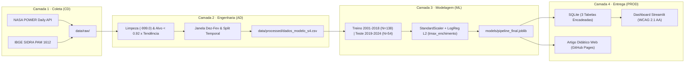

# SojaRisco | Protótipo Experimental de Monitoramento Agroclimático na Soja

**Disciplina:** Ciência de Dados e Aprendizado de Máquina (2026/2)  
**Recorte Agronômico:** Soja em Grão (`Glycine max`), microrregião do **Alto Teles Pires - MT** (9 municípios, com **Sorriso - MT**, IBGE `5107925`, como referência)  
**Status do Sistema:** **Protótipo experimental (não aprovado para decisão operacional)**  
**Fontes de Dados Abertos:** [NASA POWER Daily API](https://power.larc.nasa.gov/) & [IBGE SIDRA - Pesquisa Agrícola Municipal (PAM, Tabela 1612)](https://sidra.ibge.gov.br/tabela/1612)

---

## Links Rápidos das Entregas Oficiais

| Entrega Oficial | Acesso Público / Caminho no Repositório | Status |
| :--- | :--- | :---: |
| **Dashboard Interativo (Streamlit Cloud)** | [https://sojarisco-sorriso.streamlit.app/](https://sojarisco-sorriso.streamlit.app/) (`streamlit_app.py`) | Publicado / Experimental |
| **Artigo Técnico Web (GitHub Pages)** | [https://samukiszhsd.github.io/bx_produtividade_agricola/](https://samukiszhsd.github.io/bx_produtividade_agricola/) (`docs/index.html`) | Publicado |
| **Vídeo Pitch (90 segundos - YouTube)** | [Assistir no YouTube](https://youtu.be/gYtYT7U4eMA) | Concluído |
| **QR Code do Artigo Técnico** | [`docs/img/qrcode_artigo.png`](docs/img/qrcode_artigo.png) / [`docs/img/qrcode_artigo.svg`](docs/img/qrcode_artigo.svg) | Gerado |
| **Diário de Bordo e Histórico de Engenharia** | [`DIARIO.md`](DIARIO.md) | Atualizado |
| **Quadro de Tarefas** | [`tarefas.md`](tarefas.md) e [Quadro Oficial no Trello](https://trello.com/invite/b/6a975ab20fa3094b426c0c68/ATTI02cea94da7f784bcf30e1e3d24341426A34F2CE2/📊-projeto-de-ciencia-de-dados) | Atualizado |
| **Model Card, Dicionário de Dados & RFC** | [`docs/Model_Card.md`](docs/Model_Card.md), [`docs/Dicionario_de_Dados.md`](docs/Dicionario_de_Dados.md) e [`docs/RFC.md`](docs/RFC.md) | Atualizado |

### Equipe de Desenvolvimento (Grupo 3 - Sistemas de Informação)
- **João Guilherme Cravo** (RGM: `35880759`) - *Engenharia de Dados Idempotente, SQLite & Artigo Técnico Web*
- **Jean Carlos Silva de Almeida** (RGM: `33783276`) - *Pipelines Scikit-Learn, Split Temporal Estrito, Calibração de Limiar & Model Card*
- **Samuel Allan Nunes da Cunha** (RGM: `34524746`) - *Modelagem Supervisionada, Validação Temporal, Banco SQLite & Dashboard Streamlit*

---

## Escopo do Projeto - Canvas de Kickoff (8 Perguntas Obrigatórias)

Antes da coleta de dados, o grupo delimitou o escopo técnico e de negócio respondendo às oito perguntas do Canvas de Kickoff (detalhadas em [`docs/RFC.md`](docs/RFC.md)):

| # | Pergunta do Canvas | Resposta Definida pelo Grupo (Alto Teles Pires - MT) |
| :---: | :--- | :--- |
| **1** | **Qual evento temporal ou agrícola será investigado?** | A ocorrência de **quebra relativa de produtividade na safra de soja** (`quebra_safra = 1`), definida quando o rendimento municipal observado fica abaixo de **`0,92 × tendência_linear`** estimada somente com 5 a 10 safras anteriores do próprio município. |
| **2** | **Qual a delimitação de região, município ou cultura?** | Cultura de **Soja em Grão** em **9 municípios do Alto Teles Pires - MT** (`Ipiranga do Norte`, `Itanhangá`, `Lucas do Rio Verde`, `Nobres`, `Nova Mutum`, `Nova Ubiratã`, `Santa Rita do Trivelato`, `Sorriso` e `Tapurah`), com **Sorriso - MT** (`5107925`) como município de referência, cobrindo 24 safras (2001 a 2024, `192` observações `município × safra`). |
| **3** | **Qual é o exato horizonte de emissão do índice?** | O alerta é emitido em **março**, após o encerramento do período crítico de enchimento dos grãos (**dezembro a fevereiro**, onde dezembro pertence à safra do ano seguinte), antes do fechamento da colheita. |
| **4** | **Qual a tolerância a Falsos Positivos versus Falsos Negativos?** | **Baixa tolerância ao Falso Negativo (FN).** O critério de custo assimétrico adota razão **5:1 (`Custo = 5 × FN + FP`)**. Por isso, além da matriz de confusão e custo total, acompanhamos **Recall**, **Precisão**, **F1-Score** e **AUC-ROC**. |
| **5** | **Quem utilizará o alerta e qual ação ele apoia?** | Produtores rurais, cooperativas e analistas em **gestão de caixa, comercialização e comunicação prévia com o seguro**. **Não serve para manejo da lavoura** (o enchimento já terminou) e **não deve ser usado sozinho para negar crédito ou seguro**. |
| **6** | **Quais são as fontes de dados abertos e como elas se relacionam?** | **NASA POWER Daily API** (séries meteorológicas diárias agregadas na janela de enchimento dez–fev) e **IBGE SIDRA / PAM Tabela 1612** (rendimento municipal anual em kg/ha usado exclusivamente para gerar o rótulo `quebra_safra`). |
| **7** | **Qual é o principal risco de vazamento de dados (*Data Leakage*) e como evitá-lo?** | (1) **Vazamento do alvo:** calcular a tendência linear usando apenas safras estritamente anteriores e excluir área/produção/rendimento dos preditores; (2) **Vazamento temporal:** **Split Temporal Estrito** (Treino `2001–2018`, $N=138$, 24 quebras; Teste `2019–2024`, $N=54$, 12 quebras) e `StandardScaler` ajustado exclusivamente no treino. |
| **8** | **Como o modelo será validado e entregue como sistema vivo?** | Seleção de features contra **referência nula (`p95`)** em validação deixando uma safra de fora, calibração de limiar pelo custo `5×FN + FP` no treino, backtest expansivo (`notebooks/14_backtest_regressao_logistica.ipynb`), teste temporal congelado (`2019–2024`) e entrega em **pipeline `joblib`**, **SQLite de 3 tabelas** e **Dashboard Streamlit**. |

---

## Arquitetura do Sistema em 4 Camadas



---

## Contrato de Dados e Persistência Relacional

### Variável-Alvo e Feature Ativa Congelada

Na etapa de seleção de variáveis (notebook `08`), nenhuma família multivariável superou a referência nula (`p95`) na validação deixando uma safra de fora; somente `tmax_enchimento` manteve sinal estatístico (`AUC val = 0,648 > p95 = 0,603`). Assim, o pipeline ativo (`models/pipeline_final.joblib`) consome uma única variável padronizada via `StandardScaler` (detalhes em [`docs/Dicionario_de_Dados.md`](docs/Dicionario_de_Dados.md)):

| Variável | Papel | Definição / Regra de Cálculo | Unidade | Observação Técnica |
| :--- | :---: | :--- | :---: | :--- |
| `tmax_enchimento` | **Feature ativa** | Média da temperatura máxima diária (`T2M_MAX`) de **dezembro a fevereiro** | °C | Regra de alerta congelada: `tmax_enchimento >= 28,34 °C` (índice `>= 0,45`). Média no treino: `28,46 °C`; no teste: `29,88 °C`. |
| `quebra_safra` | **Alvo** | `1` se `rendimento_kg_ha < 0,92 × tendência_linear`, senão `0` | binária (`0`/`1`) | Tendência linear calculada com 5 a 10 safras **passadas** do mesmo município (`24` quebras no treino; `12` no teste). |

> **Importante sobre a saída:** Como o modelo usa `class_weight="balanced"`, a saída (`0,45` no limiar) é um **índice de risco térmico não calibrado**, e não a probabilidade real de perda.

### Arquitetura SQLite (`data/monitoramento_safra.db`)

O módulo [`src/database.py`](src/database.py) inicializa e popula de forma idempotente (com integridade referencial `PRAGMA foreign_keys = ON`) três tabelas encadeadas:

1. **`dados_historicos`**: série consolidada `município × safra` (`cod_municipio`, `safra`, `split`), `rendimento_kg_ha`, `quebra_safra`, `tmax_enchimento` e indicadores contextuais.
2. **`previsoes_sistemicas`**: inferências do pipeline vinculadas por chave estrangeira (`id_historico -> dados_historicos`), armazenando `probabilidade_quebra` (índice de risco), `limiar_decisao`, `alerta_quebra`, `tempo_inferencia_ms` e `origem_execucao`.
3. **`logs_monitoramento`**: trilha de auditoria operacional vinculada por chave estrangeira (`id_previsao -> previsoes_sistemicas`), registrando `nivel_log`, `mensagem`, `payload_entrada` (JSON) e timestamp.

---

## Estrutura Padronizada do Repositório

```text
bx_produtividade_agricola/
├── data/
│   ├── raw/                                  # Cache imutável das APIs (NASA POWER + IBGE PAM)
│   ├── interim/                              # Dados limpos, tratados e municípios selecionados
│   ├── processed/
│   │   └── dados_modelo_s4.csv               # Matriz oficial (192 linhas: 138 treino + 54 teste)
│   └── monitoramento_safra.db                # Banco SQLite relacional (3 tabelas encadeadas)
├── docs/
│   ├── index.html                            # Artigo Didático Web Público (GitHub Pages)
│   ├── css/style.css                         # Estilização editorial responsiva
│   ├── js/project-data.js                    # Camada centralizada de métricas e série histórica oficial
│   ├── img/                                  # Logotipos e QR Codes oficiais de acesso ao Artigo
│   ├── assets/                               # Gráficos gerados nos notebooks (limiar, deriva, árvore)
│   ├── RFC.md                                # Regras de negócio e custo assimétrico (5x FN + FP)
│   ├── Dicionario_de_Dados.md                # Contrato e linhagem das variáveis
│   └── Model_Card.md                         # Documentação completa de desempenho, ética e limitações
├── icons/                                    # Ícones SVG acessíveis usados no Dashboard Streamlit
├── models/
│   ├── pipeline_final.joblib                 # Pipeline ativo (StandardScaler + LogisticRegression L2)
│   ├── modelo_final.joblib                   # Artefato espelho do modelo ativo
│   ├── modelo_final_metadados.json           # Metadados oficiais e recortes de desempenho
│   ├── limiar_congelado.json                 # Corte ótimo da validação (0.45 / 28.34 °C) e aviso de deriva
│   ├── features_selecionadas.json            # Lista oficial da feature selecionada (tmax_enchimento)
│   ├── s4_comparacao_familias.csv            # Seleção de famílias vs referência nula (p95)
│   ├── s5_avaliacao_teste_final.csv          # Avaliação final da Sprint 5 no teste congelado
│   ├── s6_comparacao_multivariavel.csv       # Experimento multivariável (5 sinais, não promovido)
│   └── s7_comparacao_modelos.csv             # Comparação de 9 classificadores (OOF e teste diagnóstico)
├── notebooks/
│   ├── 01_coleta_de_dados.ipynb              # Ingestão NASA POWER + IBGE PAM (9 municípios)
│   ├── 02_limpeza_split_temporal.ipynb       # Tratamento de sentinelas/nulos e divisão temporal
│   ├── 03_tratamento_estatistico_residual.ipynb
│   ├── 04_alvo_e_features.ipynb              # Definição do alvo relativo (< 0.92 x tendência passada)
│   ├── 05_analise_exploratoria_eda.ipynb     # Análise exploratória regional
│   ├── 06_modelagem_baselines.ipynb          # Baselines iniciais
│   ├── 07_dummyclassifier_gaussiannb_pipeline.ipynb
│   ├── 08_engenharia_features_selecao_parcimoniosa.ipynb # Teste contra referência nula (seleção de tmax_enchimento)
│   ├── 09_retreino_baselines_pipeline_congelado.ipynb
│   ├── 10_tabela_lift_interpretacao_sprint_review.ipynb
│   ├── 11_modelagem_comparativa_novos_classificadores.ipynb
│   ├── 12_calibracao_limiar_validacao_temporal.ipynb
│   ├── 13_avaliacao_teste_congelado_model_card.ipynb
│   └── 14_backtest_regressao_logistica.ipynb # Backtest expansivo e análise de erros do modelo ativo
├── src/
│   ├── __init__.py
│   ├── coleta_api.py                         # Cache e coleta das séries
│   ├── etl_processamento.py                  # Validação idempotente da matriz oficial dados_modelo_s4.csv
│   ├── database.py                           # Inicialização e carga idempotente do SQLite (3 tabelas)
│   ├── experimento_multivariavel.py          # Experimento multivariável de 5 sinais (S6)
│   └── comparacao_modelos_multivariaveis.py  # Comparação de 9 algoritmos em validação OOF e teste (S7)
├── .env.example                              # Template de variáveis de ambiente (sem chaves sensíveis)
├── DIARIO.md                                 # Diário de bordo consolidado na raiz
├── tarefas.md                                # Rastreamento completo das tarefas do projeto
├── requirements.txt                          # Dependências Python para execução local e Streamlit Cloud
├── streamlit_app.py                          # Dashboard interativo (3 abas, WCAG 2.1 AA)
└── README.md
```

---

## Resultados Experimentais e Critério de Aprovação

Com `192` observações (`138` no treino `2001–2018` e `54` no teste temporal `2019–2024`), o critério pré-definido de aprovação exigia que o modelo tivesse **custo (`5 × FN + FP`) menor que "nunca alertar" e menor que "alertar sempre"**, tanto no teste completo quanto no teste sem 2024.

### Desempenho do Modelo Ativo (`Regressão Logística L2`, `tmax_enchimento >= 28,34 °C`)

| Conjunto / Recorte | N | Recall | Precisão | % Alertas | % Reais | Custo (`5×FN + FP`) | Baselines (Nunca / Sempre) | AUC-ROC |
| :--- | :---: | :---: | :---: | :---: | :---: | :---: | :---: | :---: |
| **Teste Completo (`2019–2024`)** | 54 | 75,0% | 23,7% | 70,4% | 22,2% | **44** | 60 / **42** | 0,728 |
| **Teste Sem 2024** | 45 | 25,0% | 3,4% | 64,4% | 8,9% | **43** | **20** / 41 | 0,341 |
| **Apenas Sorriso-MT (`2019–2024`)** | 6 | 100,0% | 50,0% | 66,7% | 33,3% | **2** | 10 / 4 | 1,000 |

### Comparativo no Teste Temporal (`2019–2024`, $N=54$) e Candidatos Multivariáveis

| Modelo | Variáveis | Recall | Precisão | F1-Score | AUC-ROC | Custo Teste | Status / Observação |
| :--- | :---: | :---: | :---: | :---: | :---: | :---: | :--- |
| `DummyClassifier (Nunca alertar)` | - | 0,0% | 0,0% | 0,000 | 0,500 | 60 | Baseline de piso (12 FN) |
| `Persistência (y_{t-1})` | 1 | 0,0% | 0,0% | 0,000 | - | 64 | Baseline temporal (12 FN, 4 FP) |
| `Alertar sempre (referência)` | - | 100,0% | 22,2% | 0,364 | - | **42** | Referência de custo a vencer (42 FP) |
| **`Regressão Logística L2 (p=0,45)`** | **1 (`tmax_enchimento`)** | **75,0%** | **23,7%** | **0,360** | **0,728** | **44** | **Protótipo experimental ativo (única com sinal > `p95` na validação)** |
| `Gaussian Naive Bayes` | 1 (`tmax_enchimento`) | 75,0% | 40,9% | 0,529 | 0,728 | 28 | Sem sinal na validação do treino (`AUC val = 0,378 < p95 = 0,485`) |
| `Árvore de Decisão (prof. 2)` | 1 (`tmax_enchimento`) | 75,0% | 23,1% | 0,353 | 0,679 | 45 | Sem sinal estatístico na validação do treino (`AUC val = 0,402`) |
| `Extra Trees raso (corte 0,50)` | 5 sinais | 75,0% | 23,7% | 0,360 | 0,627 | 44 | #1 na validação OOF (custo 39, AUC 0,721), mas não superou no teste |
| `Random Forest raso (corte 0,50)` | 5 sinais | 75,0% | 23,7% | 0,360 | 0,605 | 44 | #2 na validação OOF (custo 47, AUC 0,683), não promovido |

> **Veredito Científico:** O critério de aprovação **não foi cumprido** (`44 > 42` no teste completo e `43 > 20` sem 2024). Nos experimentos multivariáveis de 5 sinais (`tmax_enchimento`, déficit hídrico `GWETROOT < 0,70`, dias `>= 35 °C`, chuva acumulada e maior veranico), nenhum algoritmo demonstrou ganho consistente entre a validação expansiva (`OOF`) e o teste futuro; por isso **nenhum modelo novo foi promovido** e o sistema permanece classificado como **protótipo experimental**.

---

## Limitações Documentadas

1. **Poucas safras independentes:** São 18 safras no treino e 6 no teste. Municípios vizinhos compartilham o clima na mesma safra, logo `54` linhas não equivalem a `54` eventos climáticos independentes.
2. **Forte dependência de poucas safras:** Sem `2016` e `2013`, a AUC de validação no treino cai para `0,49`; no teste, `2024` concentra 8 das 12 quebras (sem `2024`, a AUC cai de `0,728` para `0,341`).
3. **Deriva climática (*Climate Drift*):** A média de `tmax_enchimento` subiu de `28,46 °C` (treino) para `29,88 °C` (teste), fazendo o limiar absoluto disparar alertas em `70%` das observações do teste.
4. **Mecanismo único:** Cobre apenas calor/seca no enchimento. Quebras por excesso de chuva ou doenças (`2002`, `2004`, `2006`, `2014`, `2022`) não são detectadas.
5. **Uso ético:** Não usar isoladamente para negar crédito, seguro rural ou orientar manejo na lavoura.

---

## Como Reproduzir o Projeto Localmente

**Pré-requisito:** `Python 3.10+` (ou acesse a versão publicada em [https://sojarisco-sorriso.streamlit.app/](https://sojarisco-sorriso.streamlit.app/)).

### 1. Configurar o Ambiente Virtual e Instalar Dependências
```bash
git clone https://github.com/SAMUKISZHSD/bx_produtividade_agricola.git
cd bx_produtividade_agricola
python3 -m venv .venv
source .venv/bin/activate
pip install -r requirements.txt
```

### 2. Validar a Base e Inicializar o Banco SQLite
```bash
python3 src/etl_processamento.py
python3 src/database.py
```

### 3. Iniciar o Dashboard Interativo no Streamlit
```bash
streamlit run streamlit_app.py
```
O painel abrirá em `http://localhost:8501` operando em **Modo REAL**, conectado ao artefato `models/pipeline_final.joblib` e ao banco `data/monitoramento_safra.db`.
