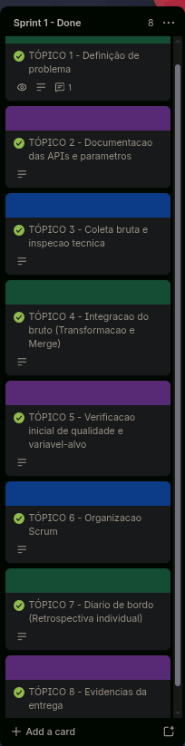

# Diario de Sprint 1 - Kickoff e Coleta Bruta Integrada

**Periodo:** 17/08/2026 a 21/09/2026  
**Trilha:** C - Risco de baixa produtividade agricola  
**Equipe:** Grupo 3  
**Integrantes:**
* Joao Guilherme Cravo (RGM: 35880759)
* Jean Carlos Silva de Almeida (RGM: 33783276)
* Samuel Allan Nunes da Cunha (RGM: 34524746)

**Scrum Master do Sprint:** Jean Carlos Silva de Almeida  
**Repositorio GitHub:** [SAMUKISZHSD/bx_produtividade_agricola](https://github.com/SAMUKISZHSD/bx_produtividade_agricola)  

> [!NOTE]
> **Aditivo de Transicao de Escopo (Sprint 2):** Conforme deliberacao tecnica para a continuidade do projeto na Sprint 2, o municipio foi migrado integralmente de Piracicaba-SP para **Sorriso-MT** (Codigo IBGE: `5107925`, Lat: `-12.5414`, Lon: `-55.7269`), refletindo os dados consolidados em `data/raw/` e a recalibracao formal do limiar de quebra de safra para `< 3.400 kg/ha` documentada no `RFC.md` v0.3 e `Dicionario_de_Dados.md` v0.2.

---

### Contrato desta Sprint

| Fluxo | Artefato | Destino / Consumidor |
|---|---|---|
| **Entrada** | Enunciado da Trilha C e APIs publicas | Base do kickoff do projeto |
| **Saida** | RFC.md v0.2 (problema, cultura, Piracicaba, horizonte, limiar formal, custo FN/FP, N esperado) | Sprint 2 e Sprint 5 |
| **Saida** | Dicionario_de_Dados.md v0.1 (fontes, codigos IBGE, variaveis brutas e regras anti-vazamento) | Sprint 2 |
| **Saida** | data/raw/ (JSONs originais integros e integrado.csv com N = 10) | Sprint 2 consome este bruto |
| **Saida** | Notebook executado notebooks/01_coleta_de_dados.ipynb e este diario de bordo | Avaliacao docente |

---

## 1. Definicao do problema (Canvas de Kickoff)

| Pergunta | Resposta Oficial do Grupo |
|---|---|
| **Qual evento sera previsto?** | Risco de baixa produtividade agricola (quebra de safra) da lavoura de soja. |
| **Para qual cultura e quais municipios?** | Soja em grao, exclusivamente no municipio de Piracicaba - SP (Codigo IBGE: 3538709). |
| **Qual e a unidade de analise?** | 1 ano-safra de soja para o municipio (1 linha = 1 safra anual). |
| **Qual e o horizonte da previsao?** | Previsao com 2 a 3 meses de antecedencia em relacao ao encerramento da colheita (durante floracao e enchimento de graos). |
| **Quem usaria o alerta e qual decisao ele apoiaria?** | Produtores rurais e cooperativas agricolas de Piracicaba, subsidiando contratacao preventiva de seguro rural e manejo adaptativo. |
| **Como e definida a classe positiva?** | 1 = Quebra de safra (rendimento medio < 2.450 kg/ha, abaixo da media historica municipal de 2.470 kg/ha). 0 = Safra normal/alta (>= 2.450 kg/ha). |
| **Quais dados estarao disponiveis no momento real da previsao?** | Variaveis agroclimaticas da NASA POWER acumuladas ate o momento da decisao. Variaveis agricolas do IBGE (area, quantidade, rendimento) sao excluidas das features por serem apuradas apenas pos-colheita. |
| **Qual e o custo de um falso negativo e de um falso positivo?** | O Falso Negativo e mais gravoso (produtor nao adota seguro ou contingenciamento e tem perda severa); o Falso Positivo gera custo dispensavel de premio securitario. |
| **Quantos municipios e safras entram no recorte (N esperado)?** | 1 municipio (Piracicaba) x 10 safras consolidadas (2015 a 2024), resultando em N = 10 safras no merge. |
| **Justificativa da escolha da Trilha C:** | Relevancia socioeconomica da soja, disponibilidade de dados meteorologicos globais via NASA POWER e serie historica oficial do IBGE PAM. |

- [x] RFC preenchido a partir deste canvas com limiar formal numerico
- [x] Dicionario v0.1 com fontes, codigos IBGE, variaveis brutas e tabela anti-vazamento
- [x] Recorte com uma cultura (Soja) e N esperado declarado (10 safras consolidadas)

---

## 2. Documentacao das APIs e parametros

**Variaveis selecionadas (4 variaveis oficiais do IBGE, sem variaveis de percentual):**

| Variavel | API / Endpoint | Unidade | Justificativa Agronomica | Papel no Projeto |
|---|---|---|---|---|
| `rendimento_kg_ha` | IBGE PAM (112) | kg/ha | Produtividade media obtida por hectare | Alvo (Target) |
| `area_plantada_ha` | IBGE PAM (109) | ha | Area total cultivada | Excluida (anti-vazamento) |
| `area_colhida_ha` | IBGE PAM (216) | ha | Area de fato colhida | Excluida (anti-vazamento) |
| `quantidade_produzida_t` | IBGE PAM (214) | toneladas | Producao total em peso | Excluida (anti-vazamento) |
| `PRECTOTCORR` | NASA POWER Daily | mm/dia | Precipitacao pluviometrica diaria | Feature preditora |
| `T2M` | NASA POWER Daily | graus C | Temperatura media diaria do ar | Feature preditora |
| `T2M_MAX` | NASA POWER Daily | graus C | Temperatura maxima diaria | Feature preditora |
| `T2M_MIN` | NASA POWER Daily | graus C | Temperatura minima diaria | Feature preditora |
| `RH2M` | NASA POWER Daily | percentual | Umidade relativa do ar | Feature preditora |
| `GWETROOT` | NASA POWER Daily | 0 a 1 | Umidade do solo na regiao das raizes | Feature preditora |

- [x] Documentacao das duas APIs registrada com endpoints, limites e parametros
- [x] Metadados do agregado 1612 do IBGE consultados (/metadados) com codigos explicados (Classificacao 81, Cultura Soja 2713, Municipio 3538709)
- [x] Selecao com filtro exato (eliminando colunas de percentual)
- [x] Registro formal de que o IBGE possui safras consolidadas ate 2024 (2025 em aberto)

---

## 3. Coleta bruta e inspecao tecnica

- [x] Estrutura config centralizada no notebook com coordenadas, datas e localidade
- [x] Requisicoes HTTP com timeout (30 e 60 segundos), try/except requests.RequestException e raise_for_status()
- [x] Inspecao tecnica completa: status_code (200), url consultada, Content-Type, headers e estrutura das chaves JSON documentados para ambas as APIs
- [x] Respostas brutas originais salvas em data/raw/nasa_power_Piracicaba_SP_2015_2025.json e data/raw/ibge_pam_Piracicaba_SP_2015_2025.json sem modificacoes
- [x] requirements.txt atualizado com as dependencias do projeto

---

## 4. Integracao do bruto (Transformacao e Merge)

- [x] Datas da NASA convertidas via pd.to_datetime(..., format='%Y%m%d')
- [x] Indicador sentinela de falha da NASA (-999.0 e -999) identificado e substituido por pd.NA
- [x] Agregacao do clima diario por ano-safra (groupby('ano')) com operacoes justificadas (soma para chuva, media para temperaturas/umidade, maximo para pico termico, minimo para frio)
- [x] Tabela do IBGE estruturada com as 4 variaveis em formato colunar por ano
- [x] Juncao realizada via pd.merge(how='inner', validate='1:1'), assegurando integridade relacional sem duplicatas
- [x] N apos o merge registrado: 10 safras consolidadas (2015 a 2024)
- [x] Tabela integrada salva em data/raw/integrado.csv

---

## 5. Verificacao inicial de qualidade e variavel-alvo

- [x] Inspecao estrutural e estatistica via .info() e .describe()
- [x] Quantificacao de ausentes por coluna (df.isna().sum())
- [x] Verificacao de duplicatas completa (df.duplicated().sum() e na chave ano)
- [x] Validacao de regras de consistencia de dominio (rendimentos negativos, chuva negativa, umidade fora de 0-100% contados sem exclusao cega)
- [x] Visualizacao temporal com matplotlib plotando a serie de rendimento da soja com titulo, eixos e unidade
- [x] Variavel-alvo codificada com limiar formal (2.450 kg/ha), gerando a coluna quebra_safra (1 = quebra, 0 = normal)
- [x] Distribuicao das classes reportada via .value_counts() em contagem e percentual

---

## 6. Organizacao Scrum

* **Product Owner:** Jean Carlos Silva de Almeida
* **Scrum Master da Sprint 1:** Joao Guilherme Cravo  
* **Equipe de Desenvolvimento:** Samuel Allan Nunes da Cunha  

**User Stories do Backlog da Sprint 1:**
1. Como desenvolvedor, preciso requisitar os dados da NASA POWER via API diaria para dispor da serie historica agroclimatica de Piracicaba-SP (2015-2025).
2. Como desenvolvedor, preciso consultar a API de Dados Agregados do IBGE PAM para obter as metricas de produtividade e area de soja consolidadas.
3. Como cientista de dados, preciso agregar o clima por ano-safra e realizar a integracao (merge 1:1) com o IBGE, gerando o arquivo data/raw/integrado.csv para servir de base as etapas subsequentes.

* **Quadro Oficial no Trello:** [Quadro Trello - Projeto de Ciência de Dados](https://trello.com/invite/b/6a975ab20fa3094b426c0c68/ATTI02cea94da7f784bcf30e1e3d24341426A34F2CE2/📊-projeto-de-ciencia-de-dados)
* **GitHub Projects:** [SAMUKISZHSD/bx_produtividade_agricola - Projects](https://github.com/users/SAMUKISZHSD/projects/)

### Evidência Visual do Quadro de Tarefas (Sprint 1)

---

## 7. Diário de bordo (Retrospectiva individual)

| Integrante | Papel Scrum | O que fiz nesta Sprint | Dificuldades | O que pretendo fazer a seguir |
|---|---|---|---|---|
| **Jean Carlos Silva** | Scrum Master / Dev (JA) | Criei o board no Trello, organizei o backlog inicial e estruturei o repositório no GitHub. Ajudei a documentar as chamadas das APIs da NASA e do IBGE (Tópico 2), dei uma revisada na checagem inicial de qualidade dos dados brutos (Tópico 5) e ajudei a fechar a RFC e os arquivos de entrega (Tópico 8). | Entender como a professora queria a divisão dos artefatos da Trilha C e garantir que todo mundo estivesse na mesma página com as regras da disciplina logo no início. | Pegar o dataset integrado na Sprint 2 para fazer a limpeza de ponta a ponta, tirar a safra 2025 que veio zoada do IBGE, gerar o arquivo limpo na pasta interim e fechar o split temporal de treino e teste. |
| **João Guilherme Cravo** | Product Owner / Dev (JS) | Ajudei a definir o problema de negócio focado na cultura de soja em Sorriso-MT (Tópico 1), fiz a integração bruta no notebook unindo os dados climáticos da NASA com a produção do IBGE PAM numa tabela só (Tópico 4), e ajudei a fechar a retrospectiva do diário (Tópico 7). | Fazer o merge bater certinho ano a ano sem perder safras e entender o formato de tabela agregada que a API do IBGE devolve no JSON. | Na Sprint 2, focar na engenharia de atributos climáticos e na definição formal da variável-alvo no notebook 04. |
| **Samuel Allan Nunes** | Dev (SA) | Escrevi as funções de requisição nas APIs da NASA POWER e do IBGE PAM no notebook 01 (Tópico 3), inspecionei as respostas brutas e os códigos sentinelas, e ajudei na organização do board e documentação Scrum (Tópico 6). | Lidar com os códigos sentinela da NASA (que usa -999.0 pra dias sem leitura) pra não enviesar os cálculos, além de filtrar só as variáveis que realmente importavam do IBGE. | Na Sprint 2, assumir a verificação residual de nulos depois do split e rodar a análise exploratória (EDA) nos dados de treino. |

---

## 8. Evidências da entrega

* **Notebook executado:** [notebooks/01_coleta_de_dados.ipynb](notebooks/01_coleta_de_dados.ipynb)
* **Tabela integrada bruta:** [data/raw/integrado.csv](data/raw/integrado.csv)
* **JSONs preservados:** `data/raw/nasa_power_Sorriso_MT_2015_2025.json` e `data/raw/ibge_pam_Sorriso_MT_2015_2025.json`
* **RFC:** [docs/RFC.md](docs/RFC.md)
* **Dicionário de Dados:** [docs/Dicionario_de_Dados.md](docs/Dicionario_de_Dados.md)

---
