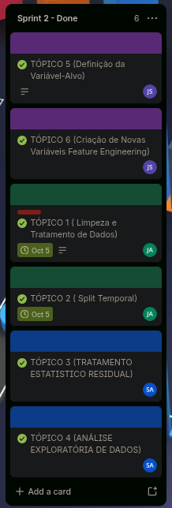

# Diário de Sprint 2 — Limpeza, tratamento, EDA e engenharia de atributos
**Período:** 18/09/2026 a 27/09/2026
**Trilha definitiva do grupo:** C — Risco de baixa produtividade agrícola

**Equipe:** João Guilherme Cravo (RGM 35880759), Jean Carlos Silva de Almeida (RGM 33783276), Samuel Allan Nunes da Cunha (RGM 34524746)  
**Scrum Master do Sprint:** Jean Carlos Silva de Almeida  
**Repositório GitHub:** [SAMUKISZHSD/bx_produtividade_agricola](https://github.com/SAMUKISZHSD/bx_produtividade_agricola)  

> [!NOTE]
> **Identificação de Gap Técnico:** Durante a inspeção e EDA inicial em Piracicaba-SP, o **João Guilherme** identificou um gap crítico: a API do IBGE PAM retornava rendimentos artificiais e repetidos de exatamente **2.400 kg/ha** por vários anos consecutivos, fazendo com que nossos gráficos não tivessem alternância e impedindo o aprendizado de máquina sobre quebras reais. Diante disso, o **Jean** pesquisou e encontrou a cidade nova, **Sorriso-MT** (polo agrícola nacional da soja), e refez os passos de coleta da Sprint 1 para o novo município. Em seguida, o **João Guilherme** refez e consolidou os passos seguintes das sprints (recalibração do alvo, engenharia de atributos e linhagem dos dados) para viabilizar um aprendizado supervisionado realista.

> A aula pode usar a **Trilha A (chuva intensa)** só como exemplo de método. **A entrega é nos dados brutos da Trilha C coletados na Sprint 1** (`data/raw/`).
>
> Ordem obrigatória: **inspeção → limpeza e tratamento → split por safra → imputação estatística só no treino (se houver NA) → EDA no treino → alvo → features**. Não se faz EDA no bruto. Não há modelagem (baseline na Sprint 3).
>
> N = municípios × safras, **depois da limpeza**. N pequeno limita features e, depois, modelos.

### Contrato desta sprint

| | Artefato | Origem / destino |
|---|---|---|
| **Entra** | `data/raw/` + `config/` + N do merge (município × safra) | Sprint 1 — **não substituir por outra coleta sem versionar** |
| **Entra** | RFC v0.1 e dicionário v0.1 | Sprint 1 |
| **Sai** | `data/interim/` + log de limpeza (N antes/depois) | Sprint 3 em diante |
| **Sai** | Split por safra (corte, N treino/teste) | Sprints 3, 4 e 5 — **mesmo corte** |
| **Sai** | Alvo formal (limiar, horizonte, desbalanceamento no treino) | Sprints 3–5 |
| **Sai** | Features iniciais justificadas + dicionário v0.2 | Sprint 3 (transformer) e 4 (base para iterar) |

**Não sai daqui:** Dummy, persistência, Naive Bayes, F1, modelo escolhido.

- [ ] Confirmei que o notebook desta sprint lê o `data/raw` da Sprint 1

---

## 1. Limpeza e tratamento (antes da EDA)

`data/raw/` permanece intocado. A tabela tratada vai para `data/interim/`.

### 1.1 Inspeção (contar o sujo, ainda sem corrigir)

- [ ] Estatística descritiva das colunas numéricas
- [ ] Ausentes quantificados por coluna
- [ ] Duplicatas (linhas e por chave município × safra)
- [ ] Valores inválidos (produtividade negativa, safra incompleta) e sentinelas da API/IBGE

**Diagnóstico (números):**

### 1.2 Regras aplicadas

Não imputar com média/mediana/moda do dataset **inteiro**. Imputação estatística, se precisar, é a seção 3 (depois do split).

- [ ] Tipos e unidades padronizados
- [ ] Duplicatas tratadas com contagem
- [ ] Sentinelas / indicadores de ausência → `NaN` explícito
- [ ] Pares município-safra incompletos tratados com regra escrita (manter, excluir ou marcar)
- [ ] Inválidos de domínio tratados com regra escrita
- [ ] Log: o que foi feito, em quantas linhas/células, N depois
- [ ] Tabela salva em `data/interim/`
- [ ] Dicionário (log de limpeza) atualizado

| Problema encontrado | Regra aplicada | Linhas/células afetadas | N depois |
|---|---|---|---|
| | | | |

**N após a limpeza (município × safra):**
**Evidências (link do notebook/commit):**

## 2. Split temporal / por safra

Sobre a tabela **já limpa** (`data/interim/`).

- [ ] Treino = safras mais antigas; teste = mais recentes (sem embaralhar o tempo)
- [ ] Corte explícito; N treino e N teste
- [ ] Teste isolado: não usa para limiar, janelas nem parâmetros de imputação

**Corte (safras treino / teste):**
**Municípios:**
**N treino / N teste:**
**Justificativa:**

## 3. Tratamento estatístico residual (depois do split, antes da EDA)

Só NA que a limpeza de domínio não resolveu. Parâmetros saem **somente do treino**.

- [ ] Estratégia justificada (imputar agora / deixar NA para o `ColumnTransformer` da Sprint 3)
- [ ] Se imputar: regra ajustada no treino e aplicada ao teste

**Regra residual (ou “não há NA restantes”):**

## 4. Análise exploratória (EDA) — treino já tratado

- [ ] Estatística descritiva da variável de origem do alvo **no treino**
- [ ] Evolução por safra, histogramas, boxplots
- [ ] Correlação no treino
- [ ] Outliers discutidos (não só plotados)

> Desbalanceamento de **classes** só depois da seção 5 (quando o alvo existir). Nesta seção explora-se a variável de origem (produtividade bruta).

**Principais achados da EDA (treino):**

**Evidências (gráficos, link do notebook):**

## 5. Definição da variável-alvo

**Classe positiva (safra de risco / baixa produtividade):**
**Limiar e justificativa (treino, alinhada ao RFC):**
**Horizonte (o que já é conhecido no momento da decisão):**
**Desbalanceamento no treino:**

- [ ] Classe positiva sem ambiguidade, ligada ao custo de FN
- [ ] Desbalanceamento das classes quantificado **no treino**
- [ ] Seção do alvo no dicionário preenchida
- [ ] Colunas de construção do alvo na lista de exclusão (vazamento)

## 6. Engenharia de atributos (Feature Engineering)

- [ ] Agregações por ciclo/safra e defasagens (safra anterior) só com informação anterior ao fim da janela de previsão
- [ ] Cada feature seria calculável **no momento real da previsão** (mesmo horizonte do RFC; sem clima posterior à decisão)
- [ ] Código IBGE / município **não** entram como número; calendário (safra, mês) vale. Município como categoria só se todos os do teste existirem no treino — e mesmo assim justificar (risco de só memorizar o lugar)
- [ ] Variáveis de calendário agrícola quando pertinente
- [ ] Parâmetros definidos **no treino**, depois aplicados ao teste
- [ ] Nada agregado após o fim da janela de decisão da safra
- [ ] Cada atributo justificado um a um; dicionário atualizado

**Descrição e justificativa dos atributos:**

**Evidências (trecho de código, link do notebook):**

## 7. Scrum

- [x] Atualizações semanais no board
- [x] Board refletindo o estado real

* **Quadro Oficial no Trello:** [Quadro Trello - Projeto de Ciência de Dados](https://trello.com/invite/b/6a975ab20fa3094b426c0c68/ATTI02cea94da7f784bcf30e1e3d24341426A34F2CE2/📊-projeto-de-ciencia-de-dados)

### Evidência Visual do Quadro de Tarefas (Sprint 2)

---

## 8. Diário de bordo (retrospectiva individual)

| Integrante | Papel Scrum | O que fiz nesta Sprint (Cards do Trello) | Dificuldades | O que pretendo manter/ajustar |
|---|---|---|---|---|
| **Jean Carlos Silva** | Scrum Master S2 / Dev (JA) | • **TÓPICO 1 (Limpeza e Tratamento de Dados):** Quando o João identificou que Piracicaba estava com o rendimento congelado em 2.400 kg/ha pelo IBGE e nossos gráficos não tinham alternância, pesquisei cidades polos da soja e encontrei Sorriso-MT. Refiz os passos de coleta da Sprint 1 para o novo município e depois peguei a tabela bruta para limpar no notebook 02. Lá identifiquei também que o IBGE tinha colocado dados não consolidados na safra de 2025 (repetindo a área sem fechar a colheita real), então descartei 2025 formalmente e salvei o dataset limpo em `data/interim/limpo.csv` com 10 safras. • **TÓPICO 2 (Split Temporal):** No mesmo notebook, fiz a separação temporal: safras de 2015 a 2022 para treino (8 anos) e 2023 a 2024 para teste (2 anos), blindando o teste contra vazamento. | Ajustar as requisições das APIs para Sorriso-MT às pressas e convencer o grupo a descartar a safra 2025 do IBGE para não sujar o treinamento. | Registrar as decisões no notebook e na Sprint 3 ajudar a estruturar o ColumnTransformer sem vazamento e o baseline de persistência. |
| **Samuel Allan Nunes** | Dev (SA) | • **TÓPICO 3 (Tratamento Estatístico Residual):** Peguei a base limpa que o Jean gerou para Sorriso e fiz o notebook 03 pra checar se tinha sobrado algum dado nulo, NaN ou valor sentinela depois do split. Verifiquei coluna por coluna e confirmei que a base estava com 100% dos dados válidos (0 nulos), então não precisamos fazer nenhuma imputação por média. • **TÓPICO 4 (Análise Exploratória de Dados - EDA):** Criei o notebook 05 para fazer a EDA completa exclusivamente em cima do bloco de treino (2015 a 2022). Com os dados novos de Sorriso, os gráficos finalmente mostraram alternância real de quebra e correlação com clima e chuva. | Segurar a ansiedade de rodar estatísticas e gráficos no dataset todo, lembrando sempre de filtrar só os dados de treino para respeitar a regra de isolamento do teste. | Gostei muito de como a EDA direcionou a escolha das features climáticas. Na Sprint 3, vou assumir o treinamento dos baselines de Dummy e Naive Bayes no Pipeline. |
| **João Guilherme Cravo** | Dev (JS) | • **TÓPICO 5 (Definição da Variável-Alvo):** Fui eu quem identificou o gap crítico de Piracicaba durante a análise preliminar: o rendimento ficava travado em 2.400 kg/ha em quase todos os anos e nossos gráficos não tinham alternância nenhuma. Alertei a equipe, o Jean buscou Sorriso-MT e refez a coleta da Sprint 1, e em seguida eu peguei a nova base limpa e refiz os passos de consolidação no notebook 04: calibrei o alvo `quebra_safra` para `< 3.400 kg/ha` (com base na média histórica de 3.476 kg/ha de Sorriso) e removi variáveis pós-colheita pra evitar target leakage. • **TÓPICO 6 (Criação de Novas Variáveis / Feature Engineering):** No mesmo notebook, consolidei as features climáticas: amplitude térmica, razão chuva por temperatura e a interação umidade do solo x chuva (`GWET_x_PREC`), salvando `data/interim/04_dados_com_features.csv`. | Detectar a anomalia dos dados estáticos do IBGE em Piracicaba a tempo de não comprometer o projeto e recalibrar o limiar agronômico para a realidade do Cerrado em Sorriso. | Continuar vigiando para nenhuma feature carregar dado pós-colheita. Na Sprint 3, vou liderar a ingestão e a governança das tarefas no Trello. |

---

## Rubrica de avaliação — Sprint 2 (nota de 0 a 4,0)

| Critério | Peso | O que caracteriza nota máxima | Nota atribuída | Observações |
|---|---|---|---|---|
| Limpeza e tratamento | 1,0 | Inspeção numérica, regras explícitas, log com N, `interim` gerado, raw intocado, sem estatística global para imputar | | |
| Split por safra/ano | 0,5 | Corte explícito na tabela limpa; teste isolado; N depois da limpeza | | |
| EDA e variável-alvo | 1,0 | EDA no treino tratado; alvo formalizado no treino; dicionário atualizado | | |
| Engenharia de atributos | 1,0 | Agregações coerentes com a safra, sem vazamento, parâmetros no treino, atributos justificados um a um | | |
| Scrum + diário de bordo | 0,5 | Board com histórico; diário reflexivo de todos | | |
| **Nota final da Sprint 2** | **4,0** | | **___ / 4,0** | |
