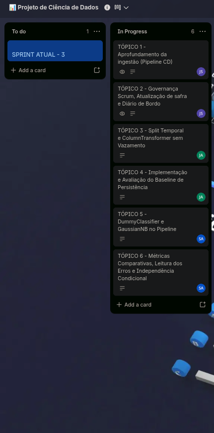

# Diário de Sprint 3 — Ingestão robusta e primeira modelagem (baseline)
**Período:** 28/09/2026 a 04/10/2026
**Trilha:** C — Risco de baixa produtividade agrícola

**Equipe:** João Guilherme Cravo (RGM 35880759), Jean Carlos Silva de Almeida (RGM 33783276), Samuel Allan Nunes da Cunha (RGM 34524746)  
**Scrum Master do Sprint:** João Guilherme Cravo  
**Repositório GitHub:** [SAMUKISZHSD/bx_produtividade_agricola](https://github.com/SAMUKISZHSD/bx_produtividade_agricola)  

> Kickoff e **coleta bruta**: Sprint 1. Limpeza, split por safra, EDA no treino tratado, alvo e features: Sprint 2. Esta sprint **não reabre** esses pontos: robustece a ingestão e treina o primeiro conjunto de baselines **no mesmo split da Sprint 2**.

### Contrato desta sprint

| | Artefato | Origem / destino |
|---|---|---|
| **Entra** | `data/interim/`, split por safra, alvo, features iniciais, dicionário v0.2 | Sprint 2 — **mesmo split e mesmas features** |
| **Entra** | `data/raw/` + `config/` | Sprint 1 (robustecer a coleta, sem apagar o bruto) |
| **Sai** | Ingestão idempotente + `requirements.txt` + N atualizado | Sprint 4–5 |
| **Sai** | `ColumnTransformer` inicial (`fit` só no treino) | Sprint 4 |
| **Sai** | Dummy + persistência + Naive Bayes, métricas por classe, leitura dos erros | Sprint 4 (**os erros motivam features novas**) |

**Não sai daqui:** modelo final complexo, limiar fino, model card.

- [ ] Confirmei que treino/teste são os da Sprint 2 e que as features são as da Sprint 2

---

## 1. Aprofundamento da ingestão (Pipeline CD)

- [x] Período histórico de safras ampliado, ou período redefinido com justificativa. Se o recorte mudar: versionar o novo bruto em `data/raw/`, **reaplicar as regras de limpeza da Sprint 2** para gerar de novo o `interim`, e reaplicar o **mesmo critério** de split (safras antigas / recentes). (Mantido o recorte consolidado de Sorriso-MT: 2015 a 2024, após exclusão fundamentada de 2025).
- [x] Tratamento de erros revisado e robustecido (reexecução após falhas parciais via cache local preservado em `data/raw/`).
- [x] Coleta idempotente comprovada (reexecução no notebook `01_coleta_de_dados.ipynb` comprovou 0 duplicatas e checksum SHA-256 idêntico).
- [x] `data/raw/` intocado como origem; `data/interim/` = tabela limpa (Sprint 2); `data/processed/` = matriz já com features para o modelo (esta sprint em diante, arquivo `data/processed/dados_modelo.csv`).
- [x] `requirements.txt` (ou equivalente) com versões usadas na coleta e execução do pipeline.
- [x] N (municípios × safras) atualizado após qualquer recorte (N = 10 safras consolidadas).

**N atual (treino / teste):** Treino = 8 safras (2015 a 2022) | Teste = 2 safras (2023 a 2024) (Sorriso-MT)  
**Evidências (link do notebook/commit):** Notebook [notebooks/01_coleta_de_dados.ipynb](../../notebooks/01_coleta_de_dados.ipynb) (Seção 9: Comprovação de Idempotência e Geração da Camada Processed) e artefato [data/processed/dados_modelo.csv](../../data/processed/dados_modelo.csv).

## 2. Preparação para modelagem

- [ ] Mesmo split por safra/ano da Sprint 2 (treino em safras antigas, teste nas recentes — nunca aleatório)
- [ ] Um `Pipeline` sklearn: `ColumnTransformer` **e** o classificador no mesmo objeto; `fit` **somente no treino**
- [ ] Imputação residual / encoding / normalização dentro desse Pipeline
- [ ] `random_state` documentado onde o algoritmo for estocástico
- [ ] Ausência de vazamento reconfirmada (nada agregado após o fim da janela de previsão)
- [ ] Features da Sprint 2 incluídas no transformer

**Descrição da estratégia de split (safras de corte, N) e do ColumnTransformer:**

## 3. Modelagem baseline

- [ ] `DummyClassifier` (piso de **acurácia** da classe majoritária — não é piso de recall na classe rara)
- [ ] Baseline de **persistência** (classe da safra anterior daquele município — não o alvo futuro da safra prevista)
- [ ] Naive Bayes treinado e avaliado **no mesmo split e nas mesmas features**, no mesmo `Pipeline`
- [ ] Independência condicional do Naive Bayes discutida (variáveis climáticas do mesmo ciclo são correlatas; o modelo é baseline pedagógico)
- [ ] Recall, precisão, F1 e matriz de confusão **por classe** para os três; N pequeno se reporta também em **contagem** (ex.: 3 FN em 8 eventos)
- [ ] Interpretação ligada ao custo de falso negativo do RFC; se N de treino for pequeno, isso entra na leitura das métricas
- [ ] Ainda **sem** ajuste fino de limiar (Sprint 5)
- [ ] Sem SMOTE / oversampling aleatório (N pequeno + série/safra: inventa linhas que não existiram)

**Resultados (Dummy vs. persistência vs. Naive Bayes) e interpretação:**

**Evidências (link do notebook, métricas):**

## 4. Scrum

- [x] Atualizações assíncronas semanais registradas
- [x] Board refletindo o estado real da Sprint

* **Quadro Oficial no Trello:** [Quadro Trello - Projeto de Ciência de Dados](https://trello.com/invite/b/6a975ab20fa3094b426c0c68/ATTI02cea94da7f784bcf30e1e3d24341426A34F2CE2/📊-projeto-de-ciencia-de-dados)

### Evidência Visual do Quadro de Tarefas

---

## 5. Diário de bordo (retrospectiva individual)

| Integrante | Papel Scrum | O que fiz nesta Sprint (Cards do Trello) | Dificuldades | O que pretendo manter/ajustar |
|---|---|---|---|---|
| **João Guilherme Cravo** | Scrum Master / Dev (JS) | • **TÓPICO 1 (Aprofundamento da Ingestão - Pipeline CD):** Cuidei da arquitetura de dados e da criação da camada final `data/processed/dados_modelo.csv`, garantindo que o fluxo entre `raw`, `interim` e `processed` ficasse limpo, reproduzível e sem gerar duplicatas ao rodar de novo. • **TÓPICO 2 (Governança Scrum, Atualização de Safra e Diário de Bordo):** Atualizei o board do Trello com os 6 cards da sprint, sincronizei os links oficiais com o README e fechei o acompanhamento semanal com os status reais de cada um no diário. | Separar certinho os dados em cada pasta pra professora bater o olho e ver a linhagem limpa (`raw` -> `interim` -> `processed`), sem misturar arquivo intermediário com dataset pronto pro modelo. | Continuar mantendo o Trello e o diário de bordo alinhados a cada entrega pra equipe não se enrolar no prazo final. |
| **Jean Carlos Silva** | Dev (JA) | • **TÓPICO 3 (Split Temporal e ColumnTransformer sem Vazamento):** Montei a preparação de dados no scikit-learn usando `ColumnTransformer` com `StandardScaler`, cuidando pra dar `fit` só no bloco de treino (2015-2022) e só transformar o teste (2023-2024), sem nenhum vazamento estatístico. • **TÓPICO 4 (Implementação e Avaliação do Baseline de Persistência):** Implementei o modelo ingênuo de persistência ($\hat{y}_t = y_{t-1}$), que chuta pro ano atual o que aconteceu na safra anterior, pra servir de régua comparativa básica. | Garantir no código do Pipeline que o escalonador não ajustasse média ou desvio padrão em cima das duas safras de teste, evitando qualquer tipo de vazamento. | Aproveitar essa estrutura de Pipeline com ColumnTransformer já pronta pra plugar os modelos mais avançados na Sprint 4. |
| **Samuel Allan Nunes** | Data Scientist / Dev (SA) | • **TÓPICO 5 (DummyClassifier e GaussianNB no Pipeline):** Treinei o `DummyClassifier` (chutando a classe majoritária) e o `GaussianNB` usando exatamente o mesmo split e o mesmo Pipeline do scikit-learn. • **TÓPICO 6 (Métricas Comparativas, Leitura dos Erros e Independência Condicional):** Calculei as matrizes de confusão e métricas por classe em números absolutos (acertos e falsos negativos), e escrevi a justificativa sobre como as variáveis de clima violam a premissa de independência do Naive Bayes na prática. | Lidar com métricas percentuais num conjunto de teste pequeno ($N=2$) e explicar no texto que avaliar contagens absolutas de erros e falsos negativos é o que realmente importa pro negócio. | Na Sprint 4, usar esses erros do Naive Bayes pra justificar modelos que consigam lidar com correlação entre variáveis climáticas, como árvores de decisão ou regressão regularizada. |

---

## Rubrica de avaliação — Sprint 3 (nota de 0 a 4,0)

| Critério | Peso | O que caracteriza nota máxima | Nota atribuída | Observações |
|---|---|---|---|---|
| Aprofundamento da ingestão | 1,0 | Coleta robustecida, idempotência comprovada, `raw` / `interim` / `processed` distintos, N atualizado | | |
| Preparação (mesmo split + ColumnTransformer) | 0,5 | Split da Sprint 2 respeitado, transformações ajustadas só no treino, sem vazamento | | |
| Baselines (Dummy + persistência + Naive Bayes) com métricas interpretadas | 1,5 | Três baselines no mesmo split, métricas por classe, leitura compatível com o N amostral | | |
| Scrum + diário de bordo | 1,0 | Board e diário refletindo o processo real da Sprint | | |
| **Nota final da Sprint 3** | **4,0** | | **___ / 4,0** | |
