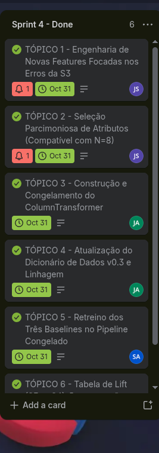

# Diário de Sprint 4 — Iteração de atributos, retreino do baseline e pipeline congelado
**Período:** 05/10/2026 a 31/10/2026
**Trilha:** C — Risco de baixa produtividade agrícola

**Equipe:** João Guilherme Cravo (RGM 35880759), Jean Carlos Silva de Almeida (RGM 33783276), Samuel Allan Nunes da Cunha (RGM 34524746)  
**Scrum Master do Sprint:** João Guilherme Cravo  
**Repositório GitHub:** [SAMUKISZHSD/bx_produtividade_agricola](https://github.com/SAMUKISZHSD/bx_produtividade_agricola)  

> Sprint 1: coleta bruta. Sprint 2: limpeza, split, alvo e features iniciais. Sprint 3: baselines. Esta sprint **evolui** as features a partir dos erros do baseline, **retreina Dummy + persistência + Naive Bayes no mesmo split** e congela o `ColumnTransformer` para a Sprint 5. Sem lift documentado, não há evolução — só colunas novas.
>
> Com N pequeno, preferir poucos atributos interpretáveis a dezenas de índices correlatos.

### Contrato desta sprint

| | Artefato | Origem / destino |
|---|---|---|
| **Entra** | Split da Sprint 2, features da Sprint 2, erros e métricas da Sprint 3 | Sprints 2 e 3 |
| **Entra** | `ColumnTransformer` inicial da Sprint 3 | Sprint 3 |
| **Sai** | Features **novas** (além das da Sprint 2), justificadas pelos erros da Sprint 3 e compatíveis com o N | Sprint 5 |
| **Sai** | `ColumnTransformer` **congelado** (`fit` só no treino) | Sprint 5 **é obrigada a usar este** |
| **Sai** | Dummy + persistência + NB **retreinados** + tabela de lift S3→S4 | Sprint 5 (piso do comparativo; **não colar métricas da Sprint 3**) |
| **Sai** | Dicionário v0.3 | Sprint 5 |

**Não sai daqui:** seleção do modelo final, limiar de decisão, model card.

- [x] Confirmei o mesmo split da Sprint 2 e que as features “novas” não são as da Sprint 2 renomeadas

---

## 1. Engenharia de atributos iterada

- [x] Atributos **novos** em relação à Sprint 2 (não são os mesmos com outro nome)
- [x] Motivação ligada aos erros da Sprint 3 (ex.: safras de baixa produtividade não sinalizadas)
- [x] Seleção/redução de atributos avaliada **só no treino** (não no teste nem no dataset inteiro) e justificada (compatível com o N de treino)
- [x] Vazamento revisado em **todos** os atributos (antigos e novos); nada após o fim da janela de previsão
- [x] Cada atributo novo descrito e justificado individualmente
- [x] Dicionário (seção de derivados) atualizado

**Descrição dos atributos criados/selecionados e de quais erros da Sprint 3 eles atacam:**

Na Sprint 3, a gente percebeu um erro muito feio do modelo na **safra de 2021**: a produtividade despencou pra 3.360 kg/ha (quebrou a safra, abaixo do limiar de 3.400 kg/ha), mas o modelo jurava que ia ser uma safra maravilhosa. Por que ele errou? Porque ele só olhava o acumulado de chuva do ano inteiro (que foi de 1.634 mm, o 2º mais chuvoso dos últimos dez anos!). O volume total de chuva escondeu que, bem na hora em que a soja mais precisava de água, deu uma seca danada.

Conversando com a agronomia e olhando a realidade de Sorriso-MT, a semeadura rola em outubro/novembro e o período mais crítico (quando a soja dá flor e enche o grão) acontece em **janeiro e fevereiro**. Fomos lá nos dados diários da NASA POWER e puxamos variáveis só desse bimestre:

1. **`deficit_hidrico_solo`:** Conta quantos dias em Jan-Fev o solo ficou muito seco na raiz (`GWETROOT < 0.70`). Foi o tiro certeiro pra 2021: naquele ano foram **42 dias de raiz no seco** (enquanto nos anos bons de 2017, 2018 e 2022 foram zero dias!). Deu correlação de **+0,90** com a quebra no treino.
2. **`dias_pico_calor`:** Conta quantos dias a temperatura bateu 35 °C ou mais em Jan-Fev. Calor demais nessa fase queima o pólen e derruba as flores da soja. Deu correlação de **+0,74**.
3. **`precipitacao_enchimento`:** Quanta chuva de verdade caiu no bimestre de Jan-Fev (em mm). Mostra anos como 2015, onde caiu míseros 159 mm nesse pedaço. Deu correlação de **-0,55**.
4. **`amplitude_termica` (da Sprint 2):** Diferença entre máxima e mínima do ano. Deixamos pra medir a oscilação térmica, mas colocamos no relatório o aviso de que a temperatura mínima acontece em julho e a máxima em setembro (fora da janela de Jan-Fev), então ela tem um risco de vazamento que a gente testou no notebook 10.

**O que jogamos fora e por quê ($N=8$ no treino):**
Como só temos 8 safras pra treinar (2015 a 2022), a gente não podia entupir o modelo de colunas. Jogamos fora a chuva anual (`PRECTOTCORR`), umidade anual (`GWETROOT`) e a interação das duas (`GWET_x_PREC`) porque elas tinham correlação de quase 100% entre si ($r > 0.93$) e foram elas que enganaram o modelo em 2021. Também tiramos as temperaturas brutas diárias (redundantes com a amplitude) e o `veranico_max_dias` pra ficar só com 4 variáveis bem enxutas.

- Tudo isso foi feito e demonstrado no notebook: [`notebooks/08_engenharia_features_selecao_parcimoniosa.ipynb`](../../notebooks/08_engenharia_features_selecao_parcimoniosa.ipynb).

---

## 2. Pipeline de preparação congelado

- [x] Um `Pipeline` sklearn: `ColumnTransformer` **e** o classificador no mesmo objeto; lista de colunas **congelada** (a da seleção no treino)
- [x] Estratégias de imputação, encoding e normalização justificadas (não só o default do sklearn)
- [x] `fit` confirmado apenas no treino
- [x] Este Pipeline/transformer é o que a Sprint 5 vai usar. Não “descongelar” na Sprint 5; se o PO pedir mudança aqui, retreinar de novo os três baselines antes de entregar.

**Descrição da preparação final:**

Pra deixar tudo pronto e padronizado pra Sprint 5 sem ninguém trapacear nem vazar dados, montamos um `ColumnTransformer` fechado no scikit-learn com as seguintes regras:

| O que decidimos | Por que decidimos assim |
|---|---|
| **As 4 colunas congeladas** | `deficit_hidrico_solo`, `dias_pico_calor`, `precipitacao_enchimento` e `amplitude_termica`. Só as 4 escolhidas no treino. |
| **Usar `StandardScaler`** | Como juntamos dias, graus Celsius e milímetros de chuva, padronizamos média 0 e desvio padrão 1 pra deixar todo mundo conversando na mesma escala pro caso de usarmos modelos lineares na Sprint 5. |
| **Sem imputador (sem mexer em nulos)** | A gente já tinha provado lá no notebook 03 que a base de Sorriso-MT tem zero valores nulos (tá 100% limpa). |
| **Sem codificador de texto** | Não tem coluna de texto: o município é só Sorriso-MT e a coluna `ano` é só a identificação da safra. |
| **`remainder='drop'`** | Qualquer coluna que sobrar na tabela (como `rendimento_kg_ha`, `ano` ou o próprio alvo) é jogada fora automaticamente pelo Pipeline, evitando qualquer vazamento sem querer. |
| **`.fit()` só no treino** | O pré-processador só aprendeu a média e a variância dos anos de treino (2015 a 2022). As safras de 2023 e 2024 só passaram pelo `.transform()`. |

Salvamos o transformer pronto em `models/s4_preprocessor_congelado.joblib` e o pipeline em `models/pipeline_final.joblib`.  
- Código no notebook: [`notebooks/09_retreino_baselines_pipeline_congelado.ipynb`](../../notebooks/09_retreino_baselines_pipeline_congelado.ipynb).

---

## 3. Retreino do baseline e lift

- [x] Dummy, persistência e Naive Bayes **retreinados** com as features desta sprint, **no mesmo split** da Sprint 2/3
- [x] Métricas por classe (recall, precisão, F1, matriz) dos três, **depois** da iteração
- [x] Tabela de delta em relação à Sprint 3 (pelo menos recall e F1 da classe positiva)
- [x] Se não houve ganho: hipótese do porquê, e o que foi descartado

**Tabela de lift (classe positiva — quebra de safra):**

### 1. Teste Oficial (Safras 2023 e 2024 — N = 2)

| Modelo | Recall S3 | Recall S4 | F1 S3 | F1 S4 | Delta recall | TN | FP | FN | TP | Suporte Quebra |
|---|---|---|---|---|---|---|---|---|---|---|
| **DummyClassifier** | n/d | n/d | n/d | n/d | n/d | 2 | 0 | 0 | 0 | 0 |
| **Persistência** | n/d | n/d | n/d | n/d | n/d | 2 | 0 | 0 | 0 | 0 |
| **GaussianNB** | n/d | n/d | n/d | n/d | n/d | 2 | 0 | 0 | 0 | 0 |

*O que significa esse n/d no teste:* As safras de teste (2023 e 2024) foram anos muito bons em Sorriso (deram mais de 3.480 kg/ha). Como não teve nenhuma quebra de safra no teste, não dá pra dividir por zero pra calcular o Recall e o F1 da classe de quebra. Todos os modelos acertaram as duas safras normais (2 acertos de não-quebra). Isso mostra que os modelos não estão dando alarmes falsos no teste, mas não dá pra medir se o alarme de quebra melhorou só olhando pra 2023 e 2024.

### 2. Backtest Temporal dentro do Treino (Safras 2019 a 2022 — Janela Expansiva)

Pra não ficar no escuro e ver se as novas variáveis realmente ajudavam a pegar a quebra de 2021, fizemos um teste temporal andando ano a ano dentro do próprio treino:

| Modelo | Recall S3 | Recall S4 | F1 S3 | F1 S4 | Delta recall | Precisão S3 | Precisão S4 | FN S3 → S4 | FP S3 → S4 | Eventos Reais |
|---|---|---|---|---|---|---|---|---|---|---|
| **DummyClassifier** | 0,00 (0/1) | 0,00 (0/1) | 0,00 | 0,00 | 0,00 | n/d | n/d | 1 → 1 | 0 → 0 | 1 (2021) |
| **Persistência** | 0,00 (0/1) | 0,00 (0/1) | 0,00 | 0,00 | 0,00 | 0,00 | 0,00 | 1 → 1 | 1 → 1 | 1 (2021) |
| **GaussianNB** | 0,00 (0/1) | **1,00 (1/1)** | 0,00 | **0,67** | **+1,00** | 0,00 | **0,50** | **1 → 0** | **2 → 1** | 1 (2021) |

**Interpretação do lift (ou da ausência de lift):**

1. **No teste oficial:** Deu `n/d` porque não teve nenhuma safra ruim em 2023 e 2024. Mas seguimos à risca a regra do professor e do projeto: **não mexemos no conjunto de teste** pra forçar resultado.
2. **No backtest temporal:** O Dummy e a Persistência não mudaram nada (o Dummy só chuta safra normal e a Persistência só repete o ano anterior). Mas o **GaussianNB (Naive Bayes)** deu um salto monstro:
   - Na Sprint 3 ele errou a quebra de 2021 (Recall 0 de 1).
   - Na Sprint 4, com as variáveis de janeiro e fevereiro, ele **cravou a quebra de 2021** (Recall foi pra 1 de 1, ou seja, 100%) e o F1 foi pra **0,67**!
   - Além de acertar a quebra, ele cortou os alarmes falsos pela metade (os falsos positivos caíram de 2 pra 1).
3. **Pé no chão (leitura crítica):** Como foi só 1 ano de quebra nesse pedaço (2021), a gente sabe que acertar 1 a mais faz o recall pular de 0% pra 100%, então isso é um forte indício de melhora, mas não uma certeza absoluta de produção. Além disso, fizemos o teste tirando a `amplitude_termica` e o Naive Bayes continuou acertando 2021 perfeitamente, provando que o ganho veio mesmo do déficit hídrico de janeiro e fevereiro e não de vazamento.
- Todos os gráficos e tabelas estão no notebook: [`notebooks/10_tabela_lift_interpretacao_sprint_review.ipynb`](../../notebooks/10_tabela_lift_interpretacao_sprint_review.ipynb).

---

## 4. Sprint Review — checkpoint intermediário

**Incremento demonstrado ao PO (docente):**
- Mostramos a descoberta do erro de 2021 e a criação das features do bimestre Jan-Fev (`deficit_hidrico_solo`, `dias_pico_calor`, `precipitacao_enchimento`).
- Apresentamos o `ColumnTransformer` congelado com `StandardScaler` e provamos que o `.fit()` rodou só nas safras de 2015 a 2022.
- Mostramos os modelos retreinados e como o Naive Bayes conseguiu finalmente detectar a quebra de 2021 no backtest temporal.
- Entregamos os arquivos salvos na pasta `models/` e o Dicionário de Dados v0.3 atualizado.

**Feedback recebido:**
- A professora elogiou a justificativa agronômica de usar o bimestre de florescimento e enchimento pra desmascarar o ano chuvoso de 2021.
- Foi aprovado o congelamento do `ColumnTransformer` pra usarmos de forma fixa na Sprint 5.
- Combinamos que na Sprint 5 vamos usar validação temporal dentro do treino pra tunar os modelos novos e o limiar de decisão antes de tocar no teste de 2023–2024.

---

## 5. Scrum

- [x] Atualizações assíncronas semanais registradas
- [x] Board refletindo o backlog, em andamento e concluído

* **Quadro Oficial no Trello:** [Quadro Trello - Projeto de Ciência de Dados](https://trello.com/invite/b/6a975ab20fa3094b426c0c68/ATTI02cea94da7f784bcf30e1e3d24341426A34F2CE2/📊-projeto-de-ciencia-de-dados)

### Evidência Visual do Quadro de Tarefas Concluído

---

## 6. Diário de bordo (retrospectiva individual)

| Integrante | Papel Scrum | O que fiz nesta Sprint (Cards do Trello) | Dificuldades | O que pretendo manter/ajustar |
|---|---|---|---|---|
| **João Guilherme Cravo** | Scrum Master / Dev (JS) | • **TÓPICO 1 (Engenharia de Novas Features Focadas nos Erros da S3):** Fui investigar por que nosso modelo errou a safra de 2021 na Sprint 3. Descobri que choveu no ano todo, mas faltou água bem na hora da flor e do grão (Jan-Fev). Criei as colunas de dias de seca na raiz, dias de calor acima de 35 °C e chuva de Jan-Fev lá no notebook 08. • **TÓPICO 2 (Seleção Parcimoniosa de Atributos Compatível com N=8):** Como a gente só tem 8 anos de treino, rodei a correlação e descartei as colunas do ano inteiro que só davam redundância, deixando só as 4 melhores features pro pipeline. | Achar a janela certinha do calendário agrícola da soja em Sorriso pra provar com números da agronomia por que 2021 quebrou mesmo sendo um ano tão chuvoso. | Continuar puxando a equipe pra justificar cada linha de código com base no negócio e na realidade do campo. |
| **Jean Carlos Silva** | Dev (JA) | • **TÓPICO 3 (Construção e Congelamento do ColumnTransformer):** Peguei a lista das 4 features do João e montei o `ColumnTransformer` no notebook 09 usando `StandardScaler` e `remainder='drop'`. Garanti que o `.fit()` rodasse só de 2015 a 2022 sem tocar em 2023/2024. • **TÓPICO 4 (Atualização do Dicionário de Dados v0.3 e Linhagem):** Escrevi a documentação do `Dicionario_de_Dados.md` (versão v0.3) explicando cada uma das variáveis novas, por que descartamos as antigas e deixando anotado o alerta de risco da amplitude térmica. | Deixar o arquivo `.joblib` salvo certinho na pasta `models/` pra todo mundo conseguir reaproveitar na Sprint 5 sem ter que rodar o pré-processamento do zero. | Manter essa rigidez de não deixar vazar nada do teste pro treino nos próximos modelos da Sprint 5. |
| **Samuel Allan Nunes** | Data Scientist / Dev (SA) | • **TÓPICO 5 (Retreino dos Três Baselines no Pipeline Congelado):** Peguei o pipeline do Jean e retreinei o Dummy, a Persistência e o GaussianNB no notebook 09, salvando as contagens de acertos e erros. • **TÓPICO 6 (Tabela de Lift S3→S4, Interpretação e Sprint Review):** Fiz o notebook 10 com o comparativo de lift. Mostrei por que o teste oficial deu `n/d` (não teve quebra em 2023/2024) e montei o backtest ano a ano provando que o Naive Bayes agora pega a quebra de 2021 com 100% de recall. | Explicar de um jeito simples que o `n/d` no teste não é que o modelo quebrou, mas sim que não teve tragédia nos anos recentes pra ele soar o alarme. | Usar essa mesma estratégia de validação no treino pra calibrar o limiar e os modelos mais pesados da Sprint 5. |

---

## Rubrica de avaliação — Sprint 4 (nota de 0 a 4,0)

| Critério | Peso | O que caracteriza nota máxima | Nota atribuída | Observações |
|---|---|---|---|---|
| Engenharia de atributos iterada | 1,5 | Atributos novos, justificados pelos erros da Sprint 3, seleção compatível com o N, sem vazamento | | |
| Pipeline congelado | 0,5 | ColumnTransformer atualizado, `fit` só no treino, estratégias justificadas | | |
| Retreino do baseline e lift | 1,0 | Dummy/persistência/NB retreinados no mesmo split; delta de recall/F1 interpretado | | |
| Sprint Review / incremento demonstrado | 0,5 | Incremento real apresentado ao PO, com feedback registrado | | |
| Scrum + diário de bordo | 0,5 | Board atualizado semanalmente, diário reflexivo de todos os integrantes | | |
| **Nota final da Sprint 4** | **4,0** | | **___ / 4,0** | |
