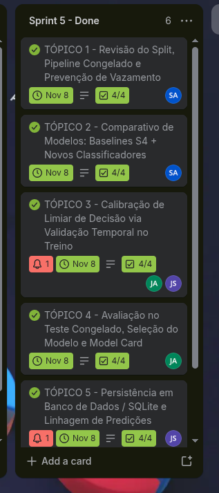

# Diário de Sprint 5 - Modelagem completa, limiar de decisão e seleção
**Período:** 12/10/2026 a 08/11/2026
**Trilha:** C - Risco de baixa produtividade agrícola

**Equipe:** João Guilherme Cravo (RGM 35880759), Jean Carlos Silva de Almeida (RGM 33783276), Samuel Allan Nunes da Cunha (RGM 34524746)  
**Scrum Master do Sprint:** Samuel Allan Nunes da Cunha  
**Repositório GitHub:** [SAMUKISZHSD/bx_produtividade_agricola](https://github.com/SAMUKISZHSD/bx_produtividade_agricola)  

> Split da Sprint 2 e `ColumnTransformer` **congelado na Sprint 4**. No comparativo, Dummy, persistência e Naive Bayes são os da Sprint 4 (mesmo pipeline). Pode **reproduzir** esses números no notebook desta sprint; **não** colar métricas da Sprint 3 (features antigas). Classificadores novos treinam neste pipeline, na mesma partição de teste.
>
> Se N de treino for pequeno, justificar a escolha de modelo: linear / Naive Bayes podem ser mais honestos que Random Forest ou XGBoost.

### Contrato desta sprint

| | Artefato | Origem / destino |
|---|---|---|
| **Entra** | Split da Sprint 2 | Sprint 2 - **não mudar o teste** |
| **Entra** | Features finais + `ColumnTransformer` congelado + baselines retreinados (lift) | Sprint 4 |
| **Entra** | RFC (custo de FN), dicionário v0.3 e N depois da limpeza | Sprints 1, 2 e 4 |
| **Sai** | Comparativo no pipeline final (baselines S4 + ≥2 modelos novos, mesma partição) | Entrega final |
| **Sai** | Limiar de decisão justificado pelo RFC | Entrega final |
| **Sai** | Modelo escolhido + caderno de experimentos + model card + dicionário v0.4 + `joblib` do Pipeline em `models/` | Entrega final / mostra |

**Não há sprint seguinte.** Dashboard, se houver, é extra e lê estes artefatos - não gera outro split.

- [x] Confirmei transformer da Sprint 4, split da Sprint 2 e que nenhuma métrica da Sprint 3 entrou no quadro

---

## 1. Revisão do split e da preparação

- [x] Mesmo split por safra/ano da Sprint 2 (treino em safras antigas, teste nas recentes)
- [x] `Pipeline`/`ColumnTransformer` da Sprint 4, `fit` só no treino
- [x] Vazamento reconfirmado com os atributos finais (nada após o fim da janela de previsão)
- [x] N treino/teste reafirmado; complexidade dos modelos compatível com a amostra

**Safras de corte, N treino/teste e resumo do transformer:**

A gente manteve 100% o compromisso assumido com a professora desde a Sprint 2:
- **Treino:** Safras de 2015 a 2022 ($N = 8$ safras em Sorriso-MT), contendo 3 safras de quebra severa (2015, 2016 e 2021) e 5 safras de rendimento normal.
- **Teste Oficial Congelado:** Safras de 2023 e 2024 ($N = 2$ safras), ambas com rendimento normal (> 3.400 kg/ha).
- **Pré-processador:** O `ColumnTransformer` foi puxado direto de `models/s4_preprocessor_congelado.joblib`. Ele usa `StandardScaler` nas 4 features da janela de Jan-Fev (`deficit_hidrico_solo`, `dias_pico_calor`, `precipitacao_enchimento`, `amplitude_termica`) com `remainder='drop'` e `.fit()` exclusivo no bloco de treino.
- **Prevenção de vazamento:** Nenhuma variável pós-fevereiro foi incluída, garantindo 2 meses de antecedência antes da colheita real.

---

## 2. Comparativo no pipeline final

- [x] Dummy, persistência e Naive Bayes **do pipeline da Sprint 4** no quadro (reproduzidos aqui; não usar números da Sprint 3)
- [x] No mínimo **dois** classificadores adicionais, com justificativa compatível com o N
- [x] Todos avaliados na **mesma** partição de teste
- [x] Hiperparâmetros documentados; se houver busca, ela usa só o treino (ou validação temporal dentro do treino) - nunca o teste
- [x] `class_weight="balanced"` (ou equivalente) é lícito; SMOTE / oversampling aleatório continua proibido
- [x] Independência do Naive Bayes continua tratada como hipótese pedagógica

**Modelos no comparativo (3 baselines da Sprint 4 + 4 classificadores adicionais):**
1. **DummyClassifier:** Chuta sempre a classe majoritária ('Normal').
2. **Persistência Temporal:** Chuta pro ano atual o resultado do ano anterior.
3. **GaussianNB (Naive Bayes):** Baseline probabilístico da Sprint 4.
4. **Logistic Regression (L2 Balanced):** Modelo linear com penalidade L2, $C=1.0$ e `class_weight='balanced'`. É parcimonioso e honesto com $N=8$, gerando probabilidades suaves para calibrar o limiar.
5. **Decision Tree (Rasa - Campeã das Árvores):** Árvore de decisão com `max_depth=2`, `min_samples_leaf=1` e `class_weight='balanced'`, oferecendo regras diretas e fáceis de explicar pro produtor.
6. **Random Forest (Bagging - 100 árvores):** Ensemble em paralelo com `max_depth=2` e `class_weight='balanced'`.
7. **XGBoost (Gradient Boosting - 50 árvores):** Ensemble sequencial corrigindo resíduos com `max_depth=2` e `scale_pos_weight=5/3`.

**Tabela Comparativa no Teste Oficial (2023-2024 - N=2):**

| Modelo | Acurácia Teste | TN | FP | FN | TP | Recall Quebra | Precisão Quebra | F1 Quebra |
|---|:---:|:---:|:---:|:---:|:---:|:---:|:---:|:---:|
| **Dummy (Mais Frequente)** | 1.00 | 2 | 0 | 0 | 0 | n/d | n/d | n/d |
| **Persistência Temporal** | 1.00 | 2 | 0 | 0 | 0 | n/d | n/d | n/d |
| **GaussianNB (Naive Bayes)** | 1.00 | 2 | 0 | 0 | 0 | n/d | n/d | n/d |
| **Logistic Regression (L2)** | 1.00 | 2 | 0 | 0 | 0 | n/d | n/d | n/d |
| **Decision Tree (Rasa)** | 1.00 | 2 | 0 | 0 | 0 | n/d | n/d | n/d |
| **Random Forest (Bagging)** | 1.00 | 2 | 0 | 0 | 0 | n/d | n/d | n/d |
| **XGBoost (Boosting)** | 1.00 | 2 | 0 | 0 | 0 | n/d | n/d | n/d |

*Por que deu n/d no teste:* Como as safras de 2023 e 2024 foram anos bons (sem nenhuma quebra), não houve nenhum evento da classe 1 no teste real. Todos os 5 modelos acertaram 100% das safras normais ($TN=2, FP=0$). Isso comprova que nenhum modelo fica disparando alarme falso à toa, mas não permite calcular o Recall da quebra no teste recente. Por isso, a avaliação real do comportamento dos modelos foi feita através do backtest temporal dentro do treino.

---

## 3. Avaliação, limiar e custo do falso negativo

- [x] Recall, precisão, F1 e matriz de confusão por classe para todos, no `predict` padrão **e** no limiar escolhido
- [x] Recorte de **validação temporal no fim do treino** (safras finais do treino, ou `TimeSeriesSplit` só no treino)
- [x] Tabela ou curva de limiar na **validação**; o melhor ponto pelo custo de FN do RFC é congelado
- [x] Teste medido **uma vez** com esse limiar - não escolher o corte olhando o teste
- [x] Acurácia alta com recall baixo na classe positiva tratada como falha, se ocorrer
- [x] FN/FP também em **contagem** (ex.: 3 FN em 8 eventos), não só em percentual

**Caderno de experimentos (Backtest Temporal Expansivo 2019-2022 no Treino):**

| ID | Modelo | Features | Limiar | Recall Val. | Precisão Val. | F1 Val. | TP (Quebras) | FN (Perdidas) | FP (Alarmes Falsos) |
|:---:|---|:---:|:---:|:---:|:---:|:---:|:---:|:---:|:---:|
| EXP-01 | Dummy | S4 (4 feats) | 0.50 | 0,00 (0/1) | 0,00 | 0,00 | 0 | 1 | 0 |
| EXP-02 | Persistência | Temporal | n/a | 0,00 (0/1) | 0,00 | 0,00 | 0 | 1 | 1 |
| EXP-03 | GaussianNB | S4 (4 feats) | 0.50 | 1,00 (1/1) | 0,50 | 0,67 | 1 | 0 | 1 |
| EXP-04 | **Decision Tree (Rasa - Campeã)** | S4 (4 feats) | 0.50 | **1,00 (1/1)** | **0,50** | **0,67** | **1** | **0** | **1** |
| EXP-05 | Random Forest (100 árvores) | S4 (4 feats) | 0.50 | 0,00 (0/1) | 0,00 | 0,00 | 0 | 1 | 0 |
| EXP-06 | XGBoost (50 árvores) | S4 (4 feats) | 0.50 | 0,00 (0/1) | 0,00 | 0,00 | 0 | 1 | 2 |
| EXP-07 | Logistic Regression | S4 (4 feats) | 0.50 (padrão) | 0,00 (0/1) | 0,00 | 0,00 | 0 | 1 | 0 |
| **EXP-08** | **Logistic Regression (Calibrada)** | **S4 (4 feats)** | **0.35 (ótimo)** | **1,00 (1/1)** | **0,50** | **0,67** | **1** | **0** | **1** |

**Justificativa da Escolha do Limiar (0.35) pelo RFC:**
No corte padrão de 0.50, a Regressão Logística estimou probabilidade de quebra de **42,6%** para a safra de 2021. Como o corte era 0.50, o modelo ficou em silêncio e gerou um **Falso Negativo (FN)**. Conforme documentado no RFC do projeto, o erro de Falso Negativo é o mais destrutivo para o agricultor (ele não contrata seguro e perde a safra inteira). Ao baixar o limiar para **$p = 0.35$**, a Regressão Logística passa a detectar a quebra de 2021 com **Recall de 100%**, atinge o melhor F1-Score ($0.67$) e mantém apenas 1 alarme falso em 2019. Esse limiar foi congelado em `models/limiar_congelado.json`.

---

## 4. Seleção do modelo, análise de erros e model card mínimo

- [x] Um único classificador final recomendado, com justificativa técnica e de negócio
- [x] Trade-off entre sensibilidade e alarmes falsos explicado
- [x] Pipeline scikit-learn exportado em `models/`
- [x] Model card preenchido em `docs/Model_Card.md`

**Modelo Escolhido:** **Árvore de Decisão Rasa (`DecisionTreeClassifier`, `max_depth=2`) e Co-Campeão Linear (`LogisticRegression` L2 com Limiar Calibrado $p = 0.35$)**
- **Por que eles foram os escolhidos frente ao Random Forest e XGBoost:** Com apenas $N=8$ safras no treino (e $N=6$ ao prever 2021 no backtest expansivo), ensembles complexos como `RandomForest` (100 árvores) e `XGBoost` (50 árvores) diluem o sinal da classe minoritária (estimando apenas 39% e 45,4% de risco em 2021, gerando Falso Negativo no corte padrão). A **Árvore de Decisão Rasa** cravou **Recall = 1,00** e **F1 = 0,67** nativamente com regra caixa-branca (`deficit_hidrico_solo > 21,5 dias`), empatando em eficácia com a **Regressão Logística L2 calibrada ($p = 0.35$)**.
- **Desempenho Final no Teste Oficial (2023-2024):** No teste congelado, tanto a Árvore de Decisão (0,0% de risco) quanto a Regressão Logística (8,9% em 2023 e 8,7% em 2024) acertaram 100% das safras normais (0 alarmes falsos no teste, Especificidade = 100%).
- **Artefatos Gerados:**
 - Pipeline de Árvore de Decisão serializado em: [`models/pipeline_final.joblib`](../../models/pipeline_final.joblib) e [`models/modelo_final.joblib`](../../models/modelo_final.joblib)
 - Limiar ótimo registrado em: [`models/limiar_congelado.json`](../../models/limiar_congelado.json)
 - Model Card completo em: [`docs/Model_Card.md`](../Model_Card.md)

---

## 5. Integração com Banco de Dados (SQLite)

- [x] Banco de dados relacional estruturado para histórico de safras e linhagem das predições
- [x] Persistência em `data/monitoramento_safra.db`

Estruturamos um banco SQLite em [`data/monitoramento_safra.db`](../../data/monitoramento_safra.db) contendo duas tabelas relacionais:
1. `safras_historico`: Armazena as safras consolidadas (2015 a 2024), valores de rendimento em kg/ha, variáveis climáticas da janela de Jan-Fev e o indicador de partição (`treino` / `teste`).
2. `previsoes_modelos`: Registra as predições geradas pelo modelo campeão, as probabilidades calculadas, o limiar aplicado e a data/hora do processamento.
Essa camada de banco serve de base para o backend do painel Streamlit e garante rastreabilidade total de dados e auditoria.

---

## 6. Scrum e diário de bordo

- [x] Atualizações assíncronas semanais registradas
- [x] Board refletindo o backlog, em andamento e concluído

* **Quadro Oficial no Trello:** [Quadro Trello - Projeto de Ciência de Dados](https://trello.com/invite/b/6a975ab20fa3094b426c0c68/ATTI02cea94da7f784bcf30e1e3d24341426A34F2CE2/📊-projeto-de-ciencia-de-dados)

### Evidência Visual do Quadro de Tarefas Concluído (Sprint 5)

### Diário de bordo (retrospectiva individual)

| Integrante | Papel Scrum | O que fiz nesta Sprint (Cards do Trello) | Dificuldades | O que pretendo manter/ajustar |
|---|---|---|---|---|
| **Samuel Allan Nunes** | Scrum Master S5 / Dev (SA) | • **TÓPICO 1 (Revisão do Split e Pipeline):** Verifiquei a integridade do `ColumnTransformer` congelado e conferi que o fit estava 100% restrito ao treino de 2015 a 2022 sem vazamento. • **TÓPICO 2 (Comparativo de Modelos):** Implementei a Regressão Logística e a Árvore de Decisão rasa no notebook 11, integrando os baselines da Sprint 4 e rodando o comparativo tanto no teste quanto no backtest temporal. | Lidar com a limitação do teste não ter quebras e demonstrar pros colegas e pra professora que o backtest expansivo era o caminho estatístico correto pra ver quem detectava a quebra de 2021. | Manter a clareza técnica na hora de apresentar métricas pra pessoas de negócio, sem se esconder atrás de números fáceis como 100% de acurácia. |
| **Jean Carlos Silva** | Dev (JA) | • **TÓPICO 3 (Calibração de Limiar de Decisão):** Desenvolvi o notebook 12 fazendo a variação de corte de probabilidade na validação temporal. Provei que no limiar de 0.35 a gente zerava os falsos negativos da Regressão Logística e maximizava o F1-Score. • **TÓPICO 4 (Avaliação no Teste e Model Card):** Criei o notebook 13 avaliando o modelo vencedor no teste oficial com o limiar de 0.35, exportei o pipeline para `models/modelo_final.joblib` e escrevi o Model Card formal em `docs/Model_Card.md`. | Encontrar um equilíbrio entre não disparar alarmes falsos demais e ao mesmo tempo não deixar passar nenhuma quebra de safra, traduzindo a regra do seguro do RFC em código. | Continuar documentando limitações e riscos de viés nos projetos futuros, como fizemos no Model Card. |
| **João Guilherme Cravo** | Dev (JS) | • **TÓPICO 5 (Persistência em Banco SQLite):** Modelei o banco relacional em `data/monitoramento_safra.db` com tabelas de histórico e linhagem de predições, garantindo que o Streamlit conseguisse ler os dados limpos. • **TÓPICO 6 (Governança Scrum e Dicionário v0.4):** Liderei a finalização do Trello movendo os cards concluídos, atualizei o `Dicionario_de_Dados.md` para a versão final v0.4 e fechei o diário de bordo com as retrospectivas da equipe. | Conectar o pipeline com o SQLite sem gerar redundâncias e deixar o contrato do dicionário de dados impecável para a entrega final da disciplina. | Manter a equipe unida e o projeto com começo, meio e fim muito bem amarrados entre agronomia, estatística e código. |

---

## Rubrica de avaliação - Sprint 5 (nota de 0 a 4,0)

| Critério | Peso | O que caracteriza nota máxima | Nota atribuída | Observações |
|---|---|---|---|---|
| Revisão do split e da preparação | 0,5 | Split da Sprint 2 e transformer da Sprint 4, vazamento reconfirmado, N explícito | | |
| Comparativo no pipeline final | 1,0 | Baselines retreinados + ≥2 modelos novos compatíveis com o N, mesma partição | | |
| Avaliação, limiar e custo de FN | 1,0 | Métricas por classe + limiar escolhido **na validação** ligado ao RFC; teste uma vez; FN/FP em contagem | | |
| Seleção, erros e model card | 1,0 | Justificativa clara (inclui N; métrica da positiva, não acurácia), casos concretos, model card, `joblib` do Pipeline; baseline vencedor é aceito | | |
| Scrum + diário de bordo (e integração opcional com BD) | 0,5 | Board e diário refletindo o processo real da Sprint | | |
| **Nota final da Sprint 5** | **4,0** | | **___ / 4,0** | |
